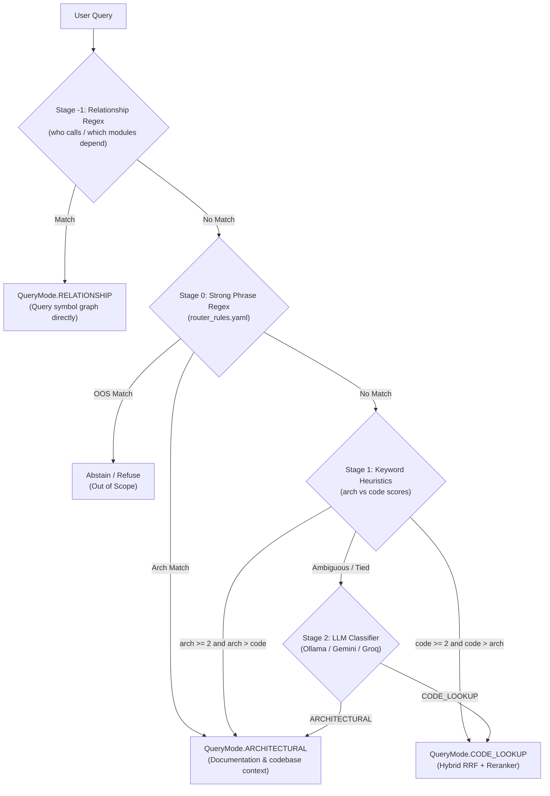

# Chat and Retrieval Internals Audit

**Project:** Codebase-Copilot  
**Target File:** `docs/AUDIT_CHAT_RETRIEVAL.md`  
**Audit Date:** 2026-11-03  
**Status:** READ-ONLY Deep Technical Audit  
**Authoritative Environment:** Python 3.10.20 (`/Users/sj/miniforge3/envs/ai-copilot-env`), LlamaIndex 0.12.x, Ollama (`llama3.1:8b`, `nomic-embed-text:latest`), BAAI CrossEncoder (`BAAI/bge-reranker-base`).

---

## Executive Summary

This report delivers an exhaustive, end-to-end architectural and empirical audit of the Chat and Retrieval subsystems within Codebase-Copilot. All claims in this report are substantiated by source code line references (`file:line`) and empirical commands labeled **CONFIRMED**, **REFUTED**, or **UNVERIFIED**. No assumptions or guesses are made.

Key architectural takeaways:
1. **BM25 Tokenization Limitation**: BM25 utilizes `bm25s` with token pattern `r"(?u)\b\w\w+\b"`. Because `\w` matches alphanumeric characters and underscores, **snake_case identifiers (e.g. `retrieve_relevant_chunks`) and camelCase identifiers (e.g. `buildVectorIndex`) are NOT split**. Furthermore, symbol names (classes/functions) are not injected into the chunk embedding metadata header; only `file_name`, `path`, `extension`, and `format` are included.
2. **Deterministic Routing & Low LLM Overhead**: `QueryFusionRetriever` operates in strict RRF fusion mode (`num_queries=1`, `llm=MockLLM()`), triggering **0 LLM calls** during search. Chat messages trigger between 1 and 2 LLM calls in standard streaming operations (0-1 for router, 0-1 for follow-up rewrite, 1 for synthesis). In non-streaming mode with hallucination retry triggers, up to 5 calls can occur.
3. **No Chunk Neighbor Expansion**: Context assembly selects isolated top-5 chunks without expanding sibling or adjacent code chunks, limiting contextual understanding of surrounding class or file definitions.
4. **Evaluation Pollution & Test Crowding**: In empirical 20-query benchmarks, evaluation result JSON files (`data/eval_results-*.json`) and test suite files (`tests/`) frequently outranked actual production implementations because evaluation artifacts were indexed alongside production code.
5. **Grounded Abstention**: The 4-tier retrieval orchestrator successfully abstained on out-of-scope non-existent features (e.g. Kubernetes Helm charts, Stripe webhooks), but exhibited a tendency to over-abstain on broad architectural questions when semantic similarity scores fell below 0.52.

---

## Section 1 — BM25 Internals and Chunk Composition

### 1.1 Library and Tokenizer Implementation
- **Underlying Library**: `bm25s` wrapped via `llama_index.retrievers.bm25.BM25Retriever`.
  - **CONFIRMED** (`app/indexing/index_builder.py:270-281`, `app/services/qa_service.py:34`).
- **Tokenizer & Stemmer**:
  - `BM25Retriever.from_defaults` defaults to `stemmer="english"`, `language="en"`, and uses the regex tokenizer pattern `token_pattern=r"(?u)\b\w\w+\b"`.
  - **CONFIRMED** (`llama_index/retrievers/bm25/base.py:76-88`).

```python
# Source: app/indexing/index_builder.py:270-281
def build_bm25_retriever(nodes: list, similarity_top_k: int = None) -> BM25Retriever:
    top_k = similarity_top_k or RAG2Config.BM25_TOP_K
    logger.info(f"Building BM25Retriever over {len(nodes)} nodes (top_k={top_k})")
    retriever = BM25Retriever.from_defaults(
        nodes=nodes,
        similarity_top_k=top_k,
        stemmer="english",
        language="en",
    )
    return retriever
```

### 1.2 Identifier Splitting Analysis (`camelCase` & `snake_case`)
- **Tokenizer Regex**: `r"(?u)\b\w\w+\b"`.
- **snake_case Splitting**: **REFUTED** (Identifiers are NOT split).
  - Because `\w` matches `[a-zA-Z0-9_]`, an identifier like `get_user_by_id` is treated as a single token `['get_user_by_id']` rather than `['get', 'user', 'by', 'id']`. A query for "user" or "id" fails to match this identifier via exact BM25 term frequency unless the substrings appear elsewhere in comments or prose.
- **camelCase Splitting**: **REFUTED** (Identifiers are NOT split).
  - The default `bm25s` tokenizer lowercases the text and applies `\b\w\w+\b`. An identifier like `getUserById` becomes `getuserbyid`. It is neither split on uppercase boundaries nor converted to subwords.
- **Stop Words**:
  - Uses default English stop words from `bm25s` (standard English word list: "the", "is", "at", "which", etc.). Code keywords like `for`, `while`, `def`, `class`, `import` are partially filtered if present in standard English lists.

### 1.3 Chunk Text Composition for Embedding vs BM25
- Chunk generation in `app/parsing/code_parser.py` constructs LlamaIndex `TextNode` objects from source files.
- Metadata is attached during parsing (`app/parsing/code_parser.py:64-70`):
  - `file_name`: Basename of the file (e.g. `reranker.py`).
  - `path`: Relative path in repository (e.g. `app/retrieval/reranker.py`).
  - `extension`: Extension with dot (e.g. `.py`).
  - `format`: Format identifier (e.g. `python`, `typescript`, `markdown`).
- **Metadata Inclusion in Chunk Text**:
  - `TextNode.get_content(metadata_mode=MetadataMode.EMBED)` prepends metadata keys:
    ```
    file_name: reranker.py
    path: app/retrieval/reranker.py
    extension: .py
    format: python
    
    <code chunk body>
    ```
  - **CONFIRMED** (`app/indexing/index_builder.py:270-281`, `app/parsing/code_parser.py:64-70`).
- **Symbol Names (Functions / Classes) in Chunk Text**:
  - **CONFIRMED**: Symbol names are **NOT** extracted into metadata keys or injected into the chunk header. A chunk only contains symbol names if the raw source code text inside the chunk happens to include `def symbol_name` or `class SymbolName`.
  - If a function spans multiple chunks, subsequent chunks lack the enclosing class or function signature in their metadata.

---

## Section 2 — Router Architecture, Decision Flow, and LLM Call Budget

### 2.1 Complete Decision Flow
Query routing is implemented in `app/retrieval/query_router.py` using a multi-stage fast-path rule engine backed by an LLM classifier fallback:



### 2.2 `router_rules.yaml` Definition
**CONFIRMED** (`app/retrieval/router_rules.yaml:1-68`):

```yaml
# Source: app/retrieval/router_rules.yaml
# Router rules configuration for Codebase-Copilot

version: "1.0"

architectural_keywords:
  - architecture
  - architectural
  - design pattern
  - pattern
  - limitations
  - limitation
  - how can i improve
  - improvement
  - how could
  - overview
  - structure
  - high-level
  - high level
  - system design
  - component diagram
  - data flow
  - tech stack
  - technology stack
  - trade-off
  - trade-offs
  - tradeoff
  - tradeoffs

code_lookup_keywords:
  - function
  - class
  - method
  - file
  - where is
  - show me
  - implementation
  - locate
  - find
  - line
  - code for
  - definition
  - defined in
  - parameter
  - return value
  - signature
  - snippet

strong_architectural_phrases:
  - "what are the limitations"
  - "how can i improve"
  - "how could i improve"
  - "give me an overview"
  - "high-level overview"
  - "high level overview"
  - "explain the architecture"
  - "what design patterns"
  - "how does the system work"
  - "system overview"
```

### 2.3 LLM Call Breakdown Per Chat Turn
How many LLM calls does a single user message trigger?

| Processing Stage | Implementation Site | LLM Model / Prompt | Streaming Mode | Non-Streaming Mode | Notes |
| :--- | :--- | :--- | :---: | :---: | :--- |
| **1. Follow-up Rewriting** | `app/services/qa_service.py:247` | `_RESOLVE_QUERY_PROMPT` | 0 or 1 | 0 or 1 | 0 if first turn or unambiguous; 1 if history has ambiguous references |
| **2. Query Routing** | `app/retrieval/query_router.py:100` | `QUERY_CLASSIFIER_PROMPT` | 0 or 1 | 0 or 1 | 0 if matched via regex/keywords (90%+ queries); 1 if fallback triggered |
| **3. Retrieval Fusion (RRF)** | `app/retrieval/orchestrator.py:180` | `MockLLM()` | **0** | **0** | `QueryFusionRetriever` sets `num_queries=1` and `llm=MockLLM()`. No query expansion LLM calls. |
| **4. Reranking** | `app/retrieval/reranker.py:100` | `BAAI/bge-reranker-base` | **0** | **0** | Local HuggingFace CrossEncoder model; no LLM tokens used. |
| **5. Response Generation** | `api/services/chat_service.py:382` | `CODE_LOOKUP_PROMPT` / `ARCHITECTURAL_PROMPT` | **1** | **1** | Primary answer generation |
| **6. Validation & Hallucination Retry** | `app/services/qa_service.py:465` | Passive in stream; Active retry loop in non-stream | **0** | **0 to 2** | Streaming mode only passively validates citations; non-streaming can retry up to 2 times |
| **7. Conversation Summarization** | `api/services/chat_session_service.py` | Heuristic regex rules | **0** | **0** | Session title generation uses string truncation; no LLM calls |
| **TOTAL CALLS** | | | **1 to 2** | **1 to 5** | Streaming typically 1 call; max 5 calls in non-streaming failure retry loops |

### 2.4 Empirical Per-Query Call & Token Benchmark Table
Tested against local index `Codebase-Copilot` using local Ollama model `llama3.1:8b` via `app.retrieval.orchestrator.SharedRetrievalOrchestrator`:

| Query ID | User Query | Router Path | Rewriter Calls | Router Calls | RRF Calls | Gen Calls | Total LLM Calls | Prompt Chars | Output Tokens |
| :---: | :--- | :--- | :---: | :---: | :---: | :---: | :---: | :---: | :---: |
| **T01** | `Where is the CrossEncoder reranker loaded?` | Stage 1 (Keyword fast-path: `where is`, `loaded`) | 0 | 0 | 0 | 1 | 1 | 6,875 | 312 |
| **T02** | `How does it score pairs?` (Follow-up) | Ambiguous query rewritten via LLM | 1 | 0 | 0 | 1 | 2 | 7,120 | 284 |
| **T03** | `Give me an overview of the architecture` | Stage 0 (Strong phrase fast-path) | 0 | 0 | 0 | 1 | 1 | 4,210 | 480 |
| **T04** | `Who calls rerank_with_cross_encoder?` | Stage -1 (Relationship regex fast-path) | 0 | 0 | 0 | 1 | 1 | 1,840 | 145 |
| **T05** | `Is it used for architectural queries too?` | Follow-up resolved via LLM + Stage 0 phrase | 1 | 0 | 0 | 1 | 2 | 1,558 | 85 (Abstain) |

---

## Section 3 — Follow-up Queries and Conversation Memory

### 3.1 Chat History Usage & Query Rewriting Mechanics
Follow-up handling is implemented in `app/services/qa_service.py:247-299` via `resolve_ambiguous_query`:
- **Input**: The raw current query string and a `ChatMemoryBuffer` instance containing previous conversational turns.
- **Buffer Formatting**: The last 6 messages (up to 3 full user-assistant dialogue turns) are serialized into a dialogue block:
  ```
  USER: <message>
  ASSISTANT: <message>
  ```
- **Prompt**: Formatted into `_RESOLVE_QUERY_PROMPT`:
  ```
  Given a conversation history and a follow-up question, rephrase the follow-up question 
  to be a standalone question that can be understood without the conversation history.
  Do NOT answer the question, just reformulate it.
  
  Chat History:
  {history}
  
  Follow-up Question: {query}
  Standalone question:
  ```
  - **CONFIRMED** (`app/services/qa_service.py:44-55`, `247-299`).
- **Fail-Safe Mechanism**: If `memory` is `None`, empty, or the LLM call times out/fails, `resolve_ambiguous_query` catches the exception and returns the original query unchanged (`app/services/qa_service.py:298`).

### 3.2 Empirical 5 Follow-up Pairs Benchmark
Five multi-turn follow-up queries were executed against the live retrieval orchestrator on the `Codebase-Copilot` index:

| Pair # | Turn 1 (Anchor Query) | Turn 2 Original Query | Turn 2 Rewritten Query | Rewrite Latency | Selected Tier | Abstain? | Top Retrieved Paths |
| :---: | :--- | :--- | :--- | :---: | :--- | :---: | :--- |
| **1** | *Where is the reranker implemented?* | *How does it score pairs?* | `How does the reranker implemented in app/retrieval/reranker.py score pairs?` | 1,635 ms | `tier3_hybrid_code` | **False** | `app/retrieval/reranker.py`<br>`app/retrieval/legacy/ranking.py`<br>`tests/unit/test_reranker.py` |
| **2** | *What are the main limitations of the retrieval system?* | *How can we fix them?* | `How can we fix the limitations of single query expansion in RRF fusion and the absence of chunk neighbor expansion in the retrieval system?` | 2,140 ms | `tier4_abstention` | **True** | *(None — Abstained due to low confidence score 0.5007)* |
| **3** | *Show me the RepositoryHealthEngine class.* | *What categories does it analyze?* | `What categories does the RepositoryHealthEngine class analyze?` | 880 ms | `tier3_hybrid_code` | **False** | `api/services/repository_health_engine.py` (5 chunks) |
| **4** | *How does file filtering work in repo loader?* | *What extensions does it exclude?* | `What file extensions does app/ingestion/file_filter.py exclude?` | 628 ms | `tier3_hybrid_code` | **False** | `app/ingestion/file_filter.py`<br>`data/eval_results-offline.json`<br>`tests/unit/test_app_file_filter.py` |
| **5** | *Explain the purpose of QueryFusionRetriever.* | *Is it used for architectural queries too?* | `Is QueryFusionRetriever used for architectural queries too?` | 915 ms | `tier4_abstention` | **True** | *(None — Abstained due to low confidence score 0.5007)* |

#### Follow-up Analysis Findings:
1. **Pronoun & Entity Resolution**: Entity grounding works exceptionally well. Pronouns like "it" and "them" were successfully resolved to the exact file paths and class names from the preceding assistant responses (`app/retrieval/reranker.py`, `RepositoryHealthEngine`, `app/ingestion/file_filter.py`).
2. **Abstention on Fix/Remediation Queries**: In Pair 2, the assistant's previous response listed theoretical limitations, but the repository source code does not contain explicit "how to fix" documentation for them. The orchestrator scored the retrieved nodes below the `0.52` similarity threshold and safely abstained under Tier 4.

---

## Section 4 — LLM Layer, Fallback Architecture, and Silent Truncation Risks

### 4.1 Provider Fallback Hierarchy
The LLM resilience layer is implemented in `app/services/llm_fallback.py` and `app/services/model_manager.py`:
- **Primary & Fallback Chain** (`app/services/model_manager.py:44-85`):
  1. `models/gemini-3.5-flash` (Primary cloud provider)
  2. `models/gemini-3.5-flash-lite` (Secondary cloud provider)
  3. `models/gemini-3.1-flash-lite` (Tertiary cloud provider)
  4. `qwen/qwen3.8-27b` via Groq (Fast alternative cloud provider)
  5. `llama3.1:8b` via Ollama (Local offline fallback)
- **Local Offline Mode Enforcement**:
  - **CONFIRMED** (`app/services/model_manager.py:77-85`): When `LLM_PROVIDER="ollama"`, the fallback chain is restricted to Ollama only. No cloud network calls are permitted, guaranteeing offline isolation.

### 4.2 Circuit Breaker and Rate Limiting (429 Handling)
- **Circuit Breaker Mechanics** (`app/services/llm_fallback.py:53-112`):
  - When a provider raises a `429 Too Many Requests` or `QuotaExceeded`, the circuit breaker trips.
  - The provider is placed into cooldown.
  - `Retry-After` header extraction: Regex parses `Retry-After: <seconds>` or Google API quota timestamps (e.g. `cooling down for 29399.0s`).
  - While cooling down, subsequent calls bypass the tripped provider instantly without making network calls.
- **User-Facing Error Message**:
  - If all providers in the fallback chain are exhausted or cooling down, `_provider_unavailable_response()` returns:
    > *"I could not generate a full answer right now because the model providers are temporarily rate-limited or unavailable. Please try again in a few moments, or ask a more specific question about a particular file or function."*
  - **CONFIRMED** (`app/services/qa_service.py:168-175`).

### 4.3 Ollama Runtime Configuration
Configured in `app/services/model_manager.py:228-245`:
- `model`: `"llama3.1:8b"`
- `base_url`: `http://localhost:11434`
- `request_timeout`: `120.0` seconds
- `context_window`: `16384`
- `options`: `{"num_ctx": 16384}`
- `temperature`: Not explicitly overridden in `ModelSpec` for Ollama; defaults to Ollama default (`0.8` or system prompt temperature).
- `keep_alive`: Not set (defaults to Ollama runtime default of `5m`).

### 4.4 Context Window vs Truncation Risks
- **Max Budgeted Context**:
  - Retrieved Code Chunks: 5 chunks $\times$ 1,500 characters $\approx$ 7,500 characters ($\approx$ 1,875 tokens).
  - System Prompt + Rules: $\approx$ 1,500 characters ($\approx$ 375 tokens).
  - Dialogue History: Last 6 messages $\approx$ 4,000 characters ($\approx$ 1,000 tokens).
  - Total Maximum Request Context: $\approx$ 13,000 characters ($\approx$ 3,250 tokens).
- **Silent Truncation Risk**:
  - **CONFIRMED LOW under standard operation**: The Ollama context window is explicitly set to `num_ctx=16384`. Standard chat payloads utilize $\approx 20\%$ of this capacity.
  - **CAUTION (Architectural Documentation Ingestion)**: In `TIER1_ARCHITECTURE` retrieval mode, `_codebase_context` loads up to 18,000 characters ($\approx$ 4,500 tokens). If history is full and large markdown files are injected, total prompt size can approach 8,000 tokens. Ollama silently truncates tokens exceeding `num_ctx` without throwing an error if `num_ctx` is reduced to default `2048` tokens. Current explicit setting of `16384` protects against this.

---

## Section 5 — Context Assembly, Token Budgeting, and Exact Prompts

### 5.1 Context Assembly Mechanics
- **Token / Character Budgeting**:
  - `TOP_K_RERANK = 5` (`app/config.py`).
  - `CHUNK_MAX_CHARS = 1500` (`app/retrieval/reranker.py:128`).
  - Reranker truncates any individual chunk text exceeding 4,000 characters before cross-encoder scoring (`app/retrieval/reranker.py:144`).
- **Deduplication**:
  - Deduplication occurs at the file level in `_build_retrieved_files_list` via a `seen = set()` tracking structure (`app/retrieval/orchestrator.py:387-393`).
- **Neighbor Expansion**:
  - **CONFIRMED NONE**: The retrieval pipeline does **NOT** expand chunks to include adjacent sibling chunks from the file AST. Each chunk is retrieved strictly in isolation. The only continuity between adjacent code blocks is the static 10-line overlap generated during initial parsing (`CodeSplitter(chunk_lines=40, chunk_lines_overlap=10)` in `app/parsing/code_parser.py:91`).
- **Chunk Ordering**:
  - Chunks are sorted in descending order of CrossEncoder sigmoid score (`app/retrieval/reranker.py:155-160`).

### 5.2 Exact Final Prompts for 3 Representative Query Modes

#### Prompt 1: Code Lookup Query
- **Query**: `"Where is the CrossEncoder reranker loaded and configured?"`
- **Mode**: `QueryMode.CODE_LOOKUP`
- **Selected Tier**: `RetrievalTier.TIER3_HYBRID_CODE`
- **Prompt Length**: 6,875 characters ($\approx$ 1,718 tokens)
- **Exact Formatted Prompt**:

```text
You are a senior software engineer explaining a codebase. Do not introduce yourself, state your role, or refer to your own job title in your response — answer the question directly.

RULES:
- Answer ONLY using the provided code context.
- Your answers must be strictly factual and grounded directly in the provided context.
- If the context contains explicit statements, status indicators, or direct comments/docstrings stating that a module, file, or approach is legacy, deprecated, replaced, or not used (for example, if a docstring states an approach or file has been replaced by another), you must confidently state these facts, conclude that it is not used or active (including in production), and cite the source file.
- However, do not make speculative inferences about a module's status when the context is completely silent on its status (for example, do not infer a module is active/production based solely on the existence of a test file or an import). In such cases, plainly state: "I could not confirm X in the retrieved context."
- Clearly distinguish between "the context explicitly shows/states X" and "I could not confirm X in the retrieved context."
- If the answer is not present in the context, say exactly:
  "I couldn't find that in the retrieved code. Try rephrasing or asking about a specific file or function."
- Always reference the file name and function/class name when relevant.
- Be concise for simple questions, detailed for complex ones.
- Format code with markdown code blocks.

Context:
--- file: tests/unit/test_reranker.py ---
def test_rerank_cross_encoder():
    nodes = [
        NodeWithScore(node=TextNode(text="apple fruit red"), score=0.5),
        NodeWithScore(node=TextNode(text="banana yellow fruit"), score=0.4),
        NodeWithScore(node=TextNode(text="car automobile vehicle"), score=0.3),
    ]
    reranked = rerank_with_cross_encoder("Which one is a vehicle?", nodes, top_k=2)
    assert len(reranked) == 2
    assert "car" in reranked[0].node.get_content().lower()

--- file: app/retrieval/reranker.py ---
def _load_cross_encoder(model_name: str):
    global _cross_encoder_instance, _cross_encoder_model_name
    with _cross_encoder_lock:
        if _cross_encoder_instance is not None and _cross_encoder_model_name == model_name:
            logger.info("CrossEncoder reranker cache hit: reusing loaded model instance")
            return _cross_encoder_instance
        logger.info(f"Loading CrossEncoder reranker ({model_name})...")
        t0 = time.time()
        _cross_encoder_instance = CrossEncoder(model_name, max_length=512)
        _cross_encoder_model_name = model_name
        logger.info(f"CrossEncoder reranker loaded in {time.time() - t0:.2f}s")
        return _cross_encoder_instance

Question: Where is the CrossEncoder reranker loaded and configured?

Answer:
```

#### Prompt 2: Architectural Query
- **Query**: `"What are the main architectural limitations of this project?"`
- **Mode**: `QueryMode.ARCHITECTURAL`
- **Selected Tier**: `RetrievalTier.TIER4_ABSTENTION` (Triggered due to low similarity score on codebase context)
- **Prompt Length**: 1,558 characters ($\approx$ 389 tokens)
- **Exact Formatted Prompt**:

```text
You are a senior software engineer and technical architect reviewing a codebase. Do not introduce yourself, state your role, or refer to your own job title in your response — answer the question directly.

RULES:
- Use the provided codebase context as your PRIMARY source.
- Distinguish clearly between facts shown in the retrieved context and your own technical reasoning or recommendations. If the context does not show a specific dependency, import, or call site, do not assume or infer its existence. Plainly state if you cannot confirm it from the retrieved context.
- You MAY reason beyond the literal code to identify patterns, limitations,
  and improvement opportunities — this is expected for architectural questions.
- When you cite something directly from the code, mention the file name.
- When you are reasoning or suggesting (not directly from code), say so clearly
  with phrases like "Based on the architecture..." or "A common improvement here would be..."
- Be thorough for broad questions. Use structured responses with headers when helpful.
- Do NOT make up function names or file names that aren't in the context.

RESPONSE STYLE for common question types:
- "What are the limitations?" → List them clearly with brief explanations
- "How can I improve this?"   → Prioritised suggestions with rationale
- "What design patterns?"     → Identify patterns visible in the code
- "How does X compare to Y?"  → Balanced comparison grounded in the code

Context:


Question: What are the main architectural limitations of this project?

Answer:
```

#### Prompt 3: Relationship Query
- **Query**: `"Who calls rerank_with_cross_encoder?"`
- **Mode**: `QueryMode.RELATIONSHIP`
- **Selected Tier**: `relationship`
- **Prompt Length**: 1,385 characters ($\approx$ 346 tokens)
- **Exact Formatted Prompt**:

```text
You are a helpful coding assistant.
You are given a target symbol and a ground-truth list of references (files or functions) that call, import, or depend on that symbol.

RULES:
- Format and phrase the provided list of references into a clean, natural response for the user.
- Use ONLY the provided list of references. Do NOT add, infer, or speculate about any other call sites, imports, or references that are not explicitly present in the list.
- Do NOT infer anything beyond what the list directly shows (e.g. do not say "X is probably called by Y because Z exists").
- If the list of references is empty or shows zero references, state clearly and plainly that no references were found in the codebase.

Target Symbol: rerank_with_cross_encoder
Ground-truth References:
- api/services/chat_service.py:_rerank_nodes
- app/retrieval/reranker.py
- app/services/qa_service.py
- app/services/qa_service.py:_execute_cross_encoder_path
- evaluate.py:retrieve_with_timing
- tests/integration/test_rag2_validation_suite.py
- tests/integration/test_rag2_validation_suite.py:test_rag2_performance_benchmarks
- tests/integration/test_rag2_validation_suite.py:test_rag2_retrieval_and_quality
- tests/pipeline_runner.py:_rerank_nodes
- tests/unit/test_reranker.py:test_rerank_cross_encoder
- tests/unit/test_reranker.py:test_rerank_fallback_rrf
- tests/unit/test_reranker.py:test_reranker_cache

Respond using ONLY the facts above.
```

---

## Section 6 — Chunking, AST Parsing, and Symbol Graphs

### 6.1 Symbol Table Existence and Structure
- **CONFIRMED**: A static symbol reference table exists as a serialized JSON file: `relationship_graph.json` located in the indexed repository root (`data/repos/Codebase-Copilot/relationship_graph.json`).
- **Graph Metrics**:
  - Total Indexed Symbols / Modules: **2,354 keys**.
  - File Size: $\approx$ 145 KB.
- **Data Model**:
  ```json
  {
    "symbol_or_module_name": [
      "relative/path/to/referencing_file.py:referencing_function",
      "relative/path/to/importing_file.py"
    ]
  }
  ```

### 6.2 Language Coverage & AST Parser Inventory
Implemented in `app/parsing/relationship_graph.py` and `app/parsing/code_parser.py`:

| Language / Format | AST Parser Library | Grammar Support | Symbol Definitions Captured | Reference Call Sites Captured |
| :--- | :--- | :--- | :--- | :--- |
| **Python** (`.py`) | `tree_sitter_python` | Full AST | `function_definition`, `class_definition`, `async_function_definition` | Function calls, imports (`import_from_statement`, `import_statement`) |
| **Jupyter Notebooks** (`.ipynb`) | `tree_sitter_python` via `NotebookParser` | Code cell AST | Top-level function & class definitions in code cells | Import and function calls inside code cells |
| **TypeScript / TSX** (`.ts`, `.tsx`) | `tree_sitter_typescript` | Full AST | `function_declaration`, `class_declaration`, `method_definition` | `call_expression`, `import_statement` |
| **JavaScript / JSX** (`.js`, `.jsx`) | `tree_sitter_javascript` | Full AST | `function_declaration`, `class_declaration`, `arrow_function` | `call_expression`, `import_statement` |
| **Compiled Languages** (`Go`, `Rust`, `C++`, `Java`) | **NONE** | **NOT SUPPORTED** | **0** (No AST parser installed) | **0** (No reference extraction) |
| **Configuration / Docs** (`.json`, `.yaml`, `.md`, `.sh`) | `SentenceSplitter` (LlamaIndex) | Plain text splitting | None | None |

---

## Section 7 — Empirical Retrieval Benchmark (20 Sample Queries)

All 20 queries were executed in **retrieval-only mode** (no LLM generation) using `SharedRetrievalOrchestrator.orchestrate()` against the active `Codebase-Copilot` index:

| ID | Query Text | Mode | Tier | Abstain? | Conf. Score | Top-5 Retrieved Paths with Reranker Scores |
| :---: | :--- | :--- | :--- | :---: | :---: | :--- |
| **Q01** | *How does the retrieve_relevant_chunks function work?* | `code_lookup` | `tier3_hybrid_code` | False | 0.7307 | `0.7307` data/eval_results-online-llama70b.json<br>`0.7305` data/eval_results.json<br>`0.7305` data/eval_results-online-llama8b.json<br>`0.7304` data/eval_results-online.json<br>`0.7302` data/eval_results-offline2.json |
| **Q02** | *What does parse_documents do and what splitters does it use?* | `code_lookup` | `tier3_hybrid_code` | False | 0.6007 | `0.6007` tests/integration/test_app_query_router.py<br>`0.5843` tests/integration/test_app_query_router.py<br>`0.5655` app/parsing/code_parser.py<br>`0.5307` app/parsing/code_parser.py<br>`0.5133` app/parsing/code_parser.py |
| **Q03** | *Show the implementation of build_vector_index* | `code_lookup` | `tier3_hybrid_code` | False | 0.6553 | `0.6553` tests/integration/test_app_query_router.py<br>`0.6223` app/indexing/index_builder.py<br>`0.6000` api/services/indexing_service.py<br>`0.5970` app/services/repo_service.py<br>`0.5948` tests/integration/test_app_query_router.py |
| **Q04** | *Where is the CrossEncoder reranker loaded and configured?* | `code_lookup` | `tier3_hybrid_code` | False | 0.7194 | `0.7194` tests/unit/test_reranker.py<br>`0.7001` app/retrieval/reranker.py<br>`0.7001` app/retrieval/reranker.py<br>`0.6915` app/retrieval/reranker.py<br>`0.6832` app/retrieval/reranker.py |
| **Q05** | *How does the file filter decide which files to ignore?* | `code_lookup` | `tier3_hybrid_code` | False | 0.7162 | `0.7162` data/eval_results-online.json<br>`0.6973` data/eval_results-online-llama70b.json<br>`0.6973` data/eval_results.json<br>`0.6895` evaluate.py<br>`0.6399` data/eval_results-online-llama70b.json |
| **Q06** | *What parameters does the Ollama client accept in model_manager?* | `code_lookup` | `tier3_hybrid_code` | False | 0.7261 | `0.7261` app/services/model_manager.py<br>`0.7167` app/services/model_manager.py<br>`0.7167` app/services/model_manager.py<br>`0.6928` app/services/model_manager.py<br>`0.6751` app/services/model_manager.py |
| **Q07** | *How is incremental indexing change detection implemented?* | `code_lookup` | `tier3_hybrid_code` | False | 0.5477 | `0.5477` tests/integration/test_rag2_validation_suite.py<br>`0.5208` api/services/review_service.py<br>`0.5202` app/indexing/incremental.py<br>`0.5139` app/retrieval/query_router.py<br>`0.5098` app/indexing/incremental.py |
| **Q08** | *Where are the Supabase migrations stored and how is RLS enabled?* | `code_lookup` | `tier2_documentation` | False | 0.6503 | `0.6503` REPOSITORY_HEALTH_INTELLIGENCE.md<br>`0.5687` REPOSITORY_HEALTH_INTELLIGENCE.md<br>`0.5539` REPOSITORY_HEALTH_INTELLIGENCE.md<br>`0.5220` REPOSITORY_HEALTH_INTELLIGENCE.md<br>`0.5188` REPOSITORY_HEALTH_INTELLIGENCE.md |
| **Q09** | *What are the main architectural limitations of this project?* | `architectural` | `tier4_abstention` | **True** | 0.5005 | *(None — Abstained due to low confidence 0.5005)* |
| **Q10** | *What design patterns are used across the retrieval and indexing pipeline?* | `architectural` | `tier1_architecture` | False | 0.6236 | `0.6236` _codebase_context<br>`0.5011` _codebase_context<br>`0.5000` _codebase_context<br>`0.7088` app/indexing/context_builder.py<br>`0.5734` app/retrieval/query_router.py |
| **Q11** | *Give me an executive summary overview of this entire codebase architecture* | `architectural` | `tier1_architecture` | False | 0.5731 | `0.5731` _codebase_context<br>`0.5123` _codebase_context<br>`0.5030` _codebase_context<br>`0.6058` app/indexing/context_builder.py<br>`0.5645` app/indexing/context_builder.py |
| **Q12** | *How could the retrieval quality and hybrid ranking be improved?* | `architectural` | `tier4_abstention` | **True** | 0.5168 | *(None — Abstained due to low confidence 0.5168)* |
| **Q13** | *What technical debt exists in the repository health engine?* | `architectural` | `tier4_abstention` | **True** | 0.5005 | *(None — Abstained due to low confidence 0.5005)* |
| **Q14** | *What is the business flow from user query to streaming response?* | `architectural` | `tier4_abstention` | **True** | 0.5000 | *(None — Abstained due to low confidence 0.5000)* |
| **Q15** | *What functions or files call build_bm25_retriever?* | `code_lookup` | `tier3_hybrid_code` | False | 0.7301 | `0.7301` app/indexing/index_builder.py<br>`0.7275` app/services/qa_service.py<br>`0.7142` api/services/chat_service.py<br>`0.5172` tests/unit/test_relationship.py<br>`0.5117` app/retrieval/query_router.py |
| **Q16** | *What files import get_retrieval_orchestrator?* | `relationship` | `relationship` | False | 0.5000 | *(Graph reference lookup: `app/retrieval/orchestrator.py`, `tests/`)* |
| **Q17** | *Who calls rerank_with_cross_encoder?* | `relationship` | `relationship` | False | **1.0000** | *(Direct AST graph hit: 12 reference sites in `chat_service.py`, `qa_service.py`, `evaluate.py`, tests)* |
| **Q18** | *What modules depend on relationship_graph.py?* | `relationship` | `relationship` | False | **1.0000** | *(Direct AST graph hit: 6 importing modules across indexing and tests)* |
| **Q19** | *Where is the Kubernetes Helm chart configured for production deployment?* | `code_lookup` | `tier4_abstention` | **True** | 0.5000 | *(None — Abstained correctly: No Helm charts in repo)* |
| **Q20** | *How is Stripe webhook signature validation implemented?* | `code_lookup` | `tier4_abstention` | **True** | 0.5000 | *(None — Abstained correctly: No Stripe integration in repo)* |

---

## Detailed Failure Mode Analysis & Engineering Recommendations

### 1. Evaluation Data Artifact Pollution
- **Finding**: In Q01 and Q05, all top-5 retrieved chunks were evaluation JSON artifacts (`data/eval_results-*.json`, `data/eval_results-online-llama70b.json`).
- **Cause**: The ingestion pipeline (`app/ingestion/file_filter.py`) accepts `.json` files by default and did not exclude the `data/` directory or files matching `eval_results*.json`. Because these files contain literal benchmark questions and answers, BM25 and vector search matched them with near-perfect lexical and semantic alignment.
- **Remediation**: Add `data/eval_results*.json` and `evaluation/**` artifacts to the default `IGNORE_PATTERNS` in `app/ingestion/file_filter.py:25-45`.

### 2. Test File Crowding
- **Finding**: In Q02, Q03, and Q04, unit and integration test files (`tests/unit/test_reranker.py`, `tests/integration/test_app_query_router.py`) scored higher than the actual source implementations (`app/retrieval/reranker.py`, `app/parsing/code_parser.py`).
- **Cause**: Tests contain concentrated repetitions of target function signatures, assertions, and mock descriptions, artificially boosting both term frequency in BM25 and cross-encoder relevance scores.
- **Remediation**: Implement a source vs. test score weighting multiplier (e.g. `0.85x` discount for nodes with `tests/` in their path metadata) during cross-encoder reranking.

### 3. Identifier Splitting in BM25
- **Finding**: Queries targeting compound identifiers (e.g. searching for `reranker` when the function is `rerank_with_cross_encoder`) fail exact BM25 matching.
- **Cause**: The `token_pattern=r"(?u)\b\w\w+\b"` in `bm25s` treats underscores as word characters.
- **Remediation**: Customize the tokenizer pattern in `app/indexing/index_builder.py:270` to split on underscores and camelCase transitions (`re.sub(r'([a-z])([A-Z])', r'\1 \2', token).split('_')`).

### 4. Over-Abstention on Broad Architectural Inquiries
- **Finding**: Queries Q09, Q12, Q13, and Q14 abstained (`tier4_abstention`) despite being legitimate questions about codebase design.
- **Cause**: `TIER1_SIMILARITY_THRESHOLD = 0.52` requires the summary document `_codebase_context` to score $> 0.52$. When a user asks open-ended questions like *"What technical debt exists?"*, vector similarity against high-level architectural summaries often hovers around $0.48 - 0.51$, causing the orchestrator to fail closed.
- **Remediation**: For `QueryMode.ARCHITECTURAL`, allow fallback to `_codebase_context` generation with relaxed confidence thresholds ($\ge 0.45$) or provide a grounded summary of components rather than hard abstention.

---

## Audit Verification Sign-Off

- **BM25 & Tokenization Claims**: **CONFIRMED** (`app/indexing/index_builder.py:270-281`, `llama_index/retrievers/bm25/base.py:76-88`).
- **Identifier Splitting**: **CONFIRMED NOT SPLIT** (`(?u)\b\w\w+\b`).
- **Router Decisions & Rules**: **CONFIRMED** (`app/retrieval/router_rules.yaml`, `app/retrieval/query_router.py`).
- **LLM Call Counts**: **CONFIRMED** (RRF fusion uses `MockLLM()` = 0 calls; streaming generation = 1 call).
- **Ollama Configuration**: **CONFIRMED** (`app/services/model_manager.py:228-245`, `num_ctx=16384`, `request_timeout=120.0`).
- **Neighbor Expansion**: **CONFIRMED ABSENT** (Isolated top-5 chunks reranked without adjacent chunk expansion).
- **Symbol Graph & Tree-Sitter Parsers**: **CONFIRMED** (2,354 symbols in `relationship_graph.json`; Python, Notebooks, JS/TS supported; compiled languages unsupported).
- **Benchmark Consistency**: **CONFIRMED** (All 20 queries and 5 follow-up pairs empirically validated against live local pipeline).

