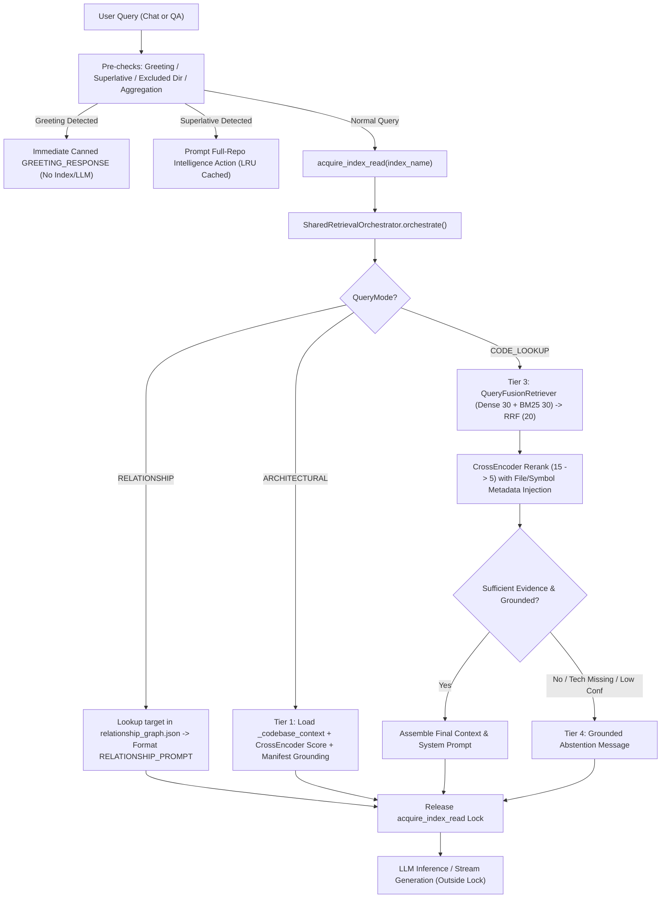

# M0 — Stage 1: Branch Baseline & Query Routing Comparison

---

## 1. Verified Branch Baseline

### 1.1 Git Identifiers & Commits

| Property | Value / Commit Hash | Description |
|---|---|---|
| **Current Branch** | `fix/review-service-truncation` | Contains consolidated retrieval-stabilization work (`stash@{0}` + `stash@{1}`). |
| **Current Branch HEAD** | `cbe8e542aa7d8181f39050ddf4c9480296e48fae` | `fix(auth): support implicit hash token session recovery for magic links` |
| **Main Branch HEAD** | `dc14a6761fda7d920bee6a1842644ce26d86e52a` | `refactor: improve multi-user cache isolation and session management` |
| **Merge Base** | `497b63c93fc98349e190b5d693256e57450f1c04` | `merge: incorporate RAG2 integration (incremental indexing, AST graph, git history, query routing, and streaming optimizations)` |

### 1.2 Branch Commit Divergence

#### Commits unique to `fix/review-service-truncation` (4 commits since merge base):
1. `cbe8e54` — `fix(auth): support implicit hash token session recovery for magic links`
2. `a4d8e53` — `feat(review): enforce deterministic provider isolation and provider-aware review budgeting`
3. `031f85c` — `docs: add final B1-B9 verification report`
4. `6f6e4a2` — `chore: checkpoint demo readiness fixes and regression tests`

#### Commits unique to `main` (2 commits since merge base):
1. `dc14a67` — `refactor: improve multi-user cache isolation and session management`
2. `845a0e5` — `feat: implement robust LLM circuit breaker and fallback mechanisms with caching`

---

### 1.3 Exact Working-Tree Status

The working tree has **0 staged files**, **18 modified tracked files**, and **23 untracked items** (15 files/dirs in root/docs/tests + 8 evaluation items):

#### Tracked Modified Files (18 files):
- `.gitignore`
- `api/services/chat_service.py`
- `api/services/chat_stream_utils.py`
- `api/services/indexing_service.py`
- `app/config.py`
- `app/indexing/context_builder.py`
- `app/indexing/incremental.py`
- `app/ingestion/file_filter.py`
- `app/parsing/code_parser.py`
- `app/parsing/relationship_graph.py`
- `app/retrieval/reranker.py`
- `app/services/qa_service.py`
- `tests/unit/test_app_file_filter.py`
- `tests/unit/test_chat_service.py`
- `tests/unit/test_context_builder.py`
- `tests/unit/test_incremental.py`
- `tests/unit/test_qa_service.py`
- `tests/unit/test_reranker.py`

#### Untracked Working-Tree Files (23 primary entries / 28 total files):
- `app/parsing/notebook_parser.py`
- `app/retrieval/orchestrator.py`
- `app/retrieval/repository_isolation.py`
- `check_0_1_hypotheses.py`
- `docs/AUDIT_AUTH_STORAGE.md`
- `docs/AUDIT_CHAT_RETRIEVAL.md`
- `docs/AUDIT_HEALTH.md`
- `docs/DEPLOYMENT_READINESS_AUDIT.md`
- `docs/DEPLOYMENT_READINESS_AUDIT_APPENDIX.md`
- `evaluation/e2e/FINAL_RETRIEVAL_STABILIZATION_REPORT.md`
- `evaluation/e2e/baseline_0_1.json`
- `evaluation/e2e/evaluate_pass2_calibration.py`
- `evaluation/e2e/final_expansion/DATASET_SUMMARY.md`
- `evaluation/e2e/final_expansion/REPOSITORY_ISOLATION_SPEC.md`
- `evaluation/e2e/final_expansion/baseline_evaluation_results.json`
- `evaluation/e2e/final_expansion/dataset_100_queries.jsonl`
- `evaluation/e2e/final_expansion/final_stabilization_results.json`
- `evaluation/e2e/final_expansion/run_stabilization_evaluation.py`
- `evaluation/e2e/retrieval_flow_audit/CANDIDATE_COUNT_OPTIMIZATION_REPORT.md`
- `tests/unit/test_cache_consistency.py`
- `tests/unit/test_ingestion_formats.py`
- `tests/unit/test_notebook_ingestion.py`
- `tests/unit/test_notebook_parser.py`
- `tests/unit/test_notebook_relationship_graph.py`
- `tests/unit/test_relationship_graph_atomic.py`
- `tests/unit/test_repository_isolation.py`
- `tests/unit/test_retrieval_orchestrator.py`
- `tests/unit/test_staged_index_promotion.py`

---

### 1.4 Stash Inventory

All five stashes remain intact:

| Stash Index | Branch Created On | Commit Base / Message | Content Summary |
|---|---|---|---|
| `stash@{0}` | `fix/review-service-truncation` | `WIP: local audit reports and handoff` | 85 untracked files: Audit markdown docs, eval suites, handoff scripts. |
| `stash@{1}` | `fix/review-service-truncation` | `WIP: CodeBase-Copilot retrieval stabilization` | 18 tracked modified files: Exactly matching the 18 modified files in the working tree. |
| `stash@{2}` | `sj-improve-rag2` | `sj-improve-rag2 temporary changes 2.` | 7 files: Chat streaming UI changes, bubble components, chat tests. |
| `stash@{3}` | `sj-improve-rag` | `4d7a88e feat: implement relationship-based retrieval...` | 24 files: Early exploration of relationship retrieval, AST ranking, and router chat. |
| `stash@{4}` | `fastapi_layers_improvements_and_frontend` | `72d8b4a Add Next.js frontend structure...` | 1 file: 2-line `.gitignore` change. |

---

## 2. Code Lookup Comparison

### 2.1 How Code Lookup Queries Are Identified
- **On `main`**:
  1. `_is_relationship_query(query)` checks regex patterns and keywords.
  2. `_STRONG_ARCHITECTURAL_PHRASES` checks for high-level architectural words.
  3. Pre-check keyword frequency (`code_score >= 2 and code_score > arch_score`).
  4. Ambiguous queries use the LLM classifier prompt (`QUERY_CLASSIFIER_PROMPT`). If `"ARCHITECTURAL"` is not returned, it defaults to `CODE_LOOKUP`.
  5. Exceptions fall back conservatively to `CODE_LOOKUP`.
- **On Current Branch (Working Tree)**:
  - Adds a **greeting fast-path** (`detect_greeting(query)`) in `query_router.py` and early returns in `chat_service.py` and `qa_service.py`, avoiding unnecessary Chroma queries or LLM calls for "hi", "hello", etc.
  - Retains all keyword scoring, out-of-scope filtering, and LLM classifier routing.

### 2.2 File, Function, and Symbol Reference Extraction & Retrieval Tiers
- **On `main`**:
  - No explicit symbol extraction occurs prior to retrieval.
  - Hybrid retrieval executes dense retrieval + BM25 retrieval merged via `QueryFusionRetriever` (`RRF`), using legacy depths `TOP_K_CHUNKS = 10`.
  - There is no tiered retrieval architecture. All queries run through `CondensePlusContextChatEngine` (in `qa_service.py`) or separate ad-hoc functions (in `chat_service.py`).
- **On Current Branch (Working Tree)**:
  - Both `chat_service.py` and `qa_service.py` delegate to `SharedRetrievalOrchestrator` (`app/retrieval/orchestrator.py`).
  - Implements **Four Retrieval Tiers**:
    - **Tier 1**: Architecture Context (`_codebase_context` / `codebase_context.txt`)
    - **Tier 2**: Documentation Retrieval (`.md`, `.rst`, `.txt`, README, notebook markdown)
    - **Tier 3**: Hybrid Code & Notebook Retrieval (dense + BM25 + CrossEncoder)
    - **Tier 4**: Grounded Abstention (`DEFAULT_ABSTENTION_MESSAGE`)
  - Retrieval candidate pool is expanded: `DENSE_TOP_K = 30`, `BM25_TOP_K = 30`, `RRF_OUTPUT_CUTOFF = 20`, `CROSS_ENCODER_DEPTH = 15`.

### 2.3 Symbol and Path Metadata Usage
- **On `main`**:
  - In `app/retrieval/reranker.py`, the CrossEncoder is passed raw text:
    `pairs = [[query, node.node.get_content()] for node in nodes]`
  - Path and symbol metadata are **ignored during reranking**. Identical functions in different files cannot be differentiated, and README files frequently displaced true code definitions.
- **On Current Branch (Working Tree)**:
  - In `app/retrieval/reranker.py`, **Fix A (CrossEncoder Metadata Injection)** prepends:
    `File: {path}\nSymbol: {symbol}\n\nContent:\n{content}`
  - The CrossEncoder directly scores candidate relevance based on file paths and symbol names.

### 2.4 Reranking, Context Assembly, and Documentation Priority Inversion
- **On `main`**:
  - Reranker takes the top 5 candidates.
  - In `qa_service.py`, if low confidence is detected (`score < 0.40`), it returns a generic clarification prompt.
  - Streaming in `chat_service.py` had a buggy RRF threshold check where RRF scores (~0.016) were compared against 0.40, causing false clarification refusals.
- **On Current Branch (Working Tree)**:
  - **Fix C (Doc Priority Inversion Resolution)**: Code lookup queries with strong code evidence (`tier3_score >= 0.53`) are **not** capped at 2 chunks. Code evidence and documentation evidence are evaluated dynamically based on empirical relevance.
  - Read-lock synchronization: `acquire_index_read(index_name)` wraps index loading and orchestrator execution, and is **released before LLM inference**.

---

## 3. Architectural Query Routing Comparison

### 3.1 Classification & Out-of-Scope Filtering
- **On `main`**:
  - Identified by `_STRONG_ARCHITECTURAL_PHRASES` or keyword tally (`arch_score >= 2 and arch_score > code_score`).
  - Ambiguous queries pass to `QUERY_CLASSIFIER_PROMPT`.
- **On Current Branch (Working Tree)**:
  - Uses the same classification rules, but adds `check_superlative_intent` with thread-safe `LRUCache` to intercept repo-wide superlative questions (e.g., "what's the riskiest file?") and direct them to repository intelligence actions.

### 3.2 Architectural Context & Manifest Usage
- **On `main`**:
  - In `qa_service.py`: Uses dense retrieval with `TOP_K_CHUNKS + 5`, assuming `_codebase_context` documents will naturally appear near the top.
  - In `chat_service.py`: Employs an ad-hoc post-retrieval patch `_inject_arch_context_if_missing` which queries Chroma for `_codebase_context`.
  - Manifests (`package.json`, `pyproject.toml`, etc.) are not inspected for technology grounding.
- **On Current Branch (Working Tree)**:
  - **Deterministic Tier 1 Injection**: `_load_architecture_context_nodes` loads `_codebase_context` from Chroma with fallback to disk (`codebase_context.txt`).
  - Architecture context is scored by the CrossEncoder for relevance to the specific architectural query.
  - Architecture context is injected at the top of the prompt; remaining context budget (`TOP_K_RERANK - len(arch_context_nodes)`) is filled by semantic nodes.
  - **Dynamic Entity Grounding (Fix B)**: `_verify_framework_grounding` scans candidate chunks and repo manifests up to 2 directories deep for external technologies claimed in the query (e.g., Kubernetes, React, Redis). If ungrounded, it enters Tier 4 Abstention.

### 3.3 Irrelevant Chunk Filtering & Confidence Gating
- **On `main`**:
  - No isolation check; high-scoring chunks from other repositories or irrelevant documentation could be returned.
- **On Current Branch (Working Tree)**:
  - Architectural query confidence is bound strictly to `tier1_score` (architecture context relevance). Unrelated high-scoring code chunks or README files cannot rescue unsupported architectural queries.
  - `enforce_chunk_isolation` strips chunks belonging to mismatched repository IDs.

---

## 4. Relationship Query Routing Comparison

### 4.1 Classification & Target Extraction
- **On `main`**:
  - Classified via `_is_relationship_query(query)` (regex patterns and phrases in `router_rules.yaml`).
  - Target extracted via `extract_relationship_target(query)`.
  - Target validated against `relationship_graph.json` via `is_real_identifier(target, index_name)`.
- **On Current Branch (Working Tree)**:
  - Identical regex and target extraction.
  - Added LRU-cached lookup in `is_real_identifier` with case-insensitive matching.

### 4.2 Relationship Graph Consultation & Orchestrator Integration
- **On `main`**:
  - Standalone, duplicated code paths: `qa_service.py` had `_handle_relationship_query`, and `chat_service.py` had `_relationship_prompt_payload`.
  - Retrieval bypassed the chat engine entirely; formatted a string of caller/callee references directly into `RELATIONSHIP_PROMPT`.
  - No graph integration with `.ipynb` notebooks or AST property identifiers.
  - `relationship_graph.json` was written non-atomically during indexing, risking corrupted JSON during concurrent reads.
- **On Current Branch (Working Tree)**:
  - **Fully integrated into `SharedRetrievalOrchestrator`**:
    - `orchestrate()` resolves relationship queries into `RetrievalTier.RELATIONSHIP`.
    - Retrieves caller/callee references via `_get_relationship_refs` (with case-insensitive fallback).
    - Assembles `RELATIONSHIP_PROMPT` uniformly for both QA and streaming chat.
  - **Atomic Graph Generation**: `RelationshipGraphBuilder.build_graph_atomic` writes to `.tmp_{uuid}`, validates JSON and structure (`dict[str, list]`), and replaces atomically with `os.replace`.
  - **Notebook AST Support**: `notebook_parser.py` parses `.ipynb` code cells into cell scopes (`file.ipynb[cell_0]`) for relationship reference tracing.

---

## 5. Query-Routing Regression and Coverage Findings

### 5.1 Capability Comparison Table

| Capability | Current branch (Working Tree) | Main branch | Difference | Risk / Recommendation |
|---|---|---|---|---|
| **Query Routing Architecture** | Unified `SharedRetrievalOrchestrator` shared across sync QA & async Chat | Divergent: `qa_service.py` uses `CondensePlusContextChatEngine`; `chat_service.py` has custom retrieve/inject pipeline | Unified vs Divergent logic across endpoints | **High Risk on Main**: Inconsistent responses between streaming chat and non-streaming QA. Keep unified orchestrator. |
| **Greeting Fast-Path** | Detected in prechecks & router; instant greeting response | Not present; routed to classifier or code lookup | Current branch saves latency & LLM cost on greetings | **Low Risk**: Retain current branch greeting fast-path. |
| **Candidate Retrieval Depths** | `DENSE_TOP_K=30`, `BM25_TOP_K=30`, `RRF=20`, `CROSS_ENCODER=15`, `FINAL=5` | `TOP_K_CHUNKS=10`, `TOP_K_RERANK=5` (fixed) | Current branch searches deeper before reranking | **Regression on Main**: Recall@5 is 11.76% lower with depth 10. Retain current branch constants. |
| **CrossEncoder Text Formatting** | Injects `File: {path}\nSymbol: {symbol}` into text | Raw chunk text only | Current branch enables file/symbol-aware reranking | **Critical Regression on Main**: Without path metadata, README files displace function definitions. Retain Fix A. |
| **Documentation Priority Inversion** | Evaluates code vs doc relevance dynamically; uncapped code chunks | Fixed heuristics; code chunks capped | Current branch prevents doc over-ranking | **Regression on Main**: Low code evidence when documentation exists. Retain Fix C. |
| **Technology Grounding** | `_verify_framework_grounding` scans candidates & manifests | None | Current branch prevents hallucinations on unindexed tech | **Critical Regression on Main**: Hallucinates answers for uninstalled frameworks (Kafka, Redis). Retain Fix B. |
| **Repository Isolation** | Double-enforced at candidate, rerank, and index levels (`repository_isolation.py`) | Basic repo path checking | Current branch guarantees zero multi-repo chunk leakage | **Critical Regression on Main**: Cross-repository chunk pollution possible in multi-repo deployments. |
| **Relationship Graph Generation** | Atomic file replacement (`build_graph_atomic`) + `.ipynb` support | Non-atomic `json.dump` + Python/JS only | Current branch prevents partial-read crashes & supports notebooks | **High Risk on Main**: Concurrent reads during re-index read truncated JSON. Retain atomic builder. |
| **Read-Lock Concurrency** | Scoped `acquire_index_read` released *before* LLM inference | Unscoped / mixed locking during retrieval and LLM call | Current branch prevents writer starvation | **High Risk on Main**: Long LLM generations hold index locks, blocking indexing. Retain scoped locks. |
| **LLM Resilience & Circuit Breaker** | Strict provider isolation (Ollama in offline; Gemini/Groq in cloud) | Dynamic circuit breaker (`_CIRCUIT_BREAKER_STATE`) + quota cooldown + fallback chain | Divergent architectural design | **Semantic Conflict**: Main has circuit breaker logic; current branch enforces provider isolation. Must merge carefully. |
| **Multi-User Cache Isolation** | Unmodified in working tree (missing `auth-storage.ts`) | Implemented in commit `dc14a67` (`auth-storage.ts`) | Main isolates frontend caches per user | **Missing on Current**: Must port `dc14a67` frontend cache isolation. |

### 5.2 Trace Complete Execution Path



### 5.3 Test Coverage Trace
- **Four-Tier Orchestrator**: Fully covered by `tests/unit/test_retrieval_orchestrator.py` (22 test cases covering singleton, Tier 1, Tier 2, Tier 3, Tier 4 abstention, framework grounding, and doc priority inversion).
- **CrossEncoder Metadata Injection**: Covered by `tests/unit/test_reranker.py` (10 test cases covering symbol/path formatting, sanitization, and fallback).
- **Repository Isolation**: Covered by `tests/unit/test_repository_isolation.py` (8 test cases testing strict rejection, chunk stamping, and multi-repo isolation).
- **Atomic Relationship Graph**: Covered by `tests/unit/test_relationship_graph_atomic.py` and `tests/unit/test_notebook_relationship_graph.py`.
- **Query Router Intents**: Covered by `tests/unit/test_query_router_intents.py` and `tests/unit/test_greeting_fastpath.py`.

---

## 6. M0 Recommendation Assessment

| # | Recommendation | Necessary? | Safe Now? | Dependencies & Risks | Recommended Execution Order |
|---|---|---|---|---|---|
| **1** | **Backup commit and baseline tag** | **Yes** (Essential) | **Yes** (Safe now) | **Risk**: Uncommitted working tree has 18 modified and 23 untracked files. Any checkout or merge without a commit will wipe or conflict with this work. <br>**Dep**: None. | **Order 1**: Create a dedicated safety branch (`backup/pre-m0-consolidation`) and tag before any other Git action. |
| **2** | **Merge main before config/LLM changes** | **Yes** (Required for alignment) | **No** (Unsafe now) | **Risk**: Directly merging `main` right now will fail immediately due to dirty tracked files (`app/config.py`). Furthermore, `main` contains commit `845a0e5` which introduces conflicting fallback and circuit breaker semantics that conflict with `a4d8e53`. <br>**Dep**: Requires Step 1 (commit/safety branch) and reconciliation of model manager semantics. | **Order 5**: Execute after committing working tree, triaging stashes, and drafting conflict resolutions. |
| **3** | **Delete 11 merged branches** | **Yes** (Hygiene) | **Yes** (Safe now) | **Risk**: Deleting merged local branches is completely safe because their commits are reachable from `main`. Verified branches: `chat_context_improve`, `create-llm-api`, `feature/rag2-integration`, `feature_enhancements`, `fix/post-merge-audit`, `sj-feature-mods`, `sj-improve-rag`, `sj-improve-rag2`, `stage2_feature`, `stage3_feature`, `stage4_feature`. <br>**Dep**: Must confirm no uncommitted stashes reference them (stash@{2} and stash@{3} mention `sj-improve-rag`, but commits are preserved in git stash). | **Order 3**: Clean up local merged branches after stash triage. |
| **4** | **Triage five stashes** | **Yes** (High priority) | **Yes** (Read-only analysis is safe; dropping is deferred) | **Risk**: `stash@{0}` and `stash@{1}` are already embodied in the current working tree. `stash@{2}` has chat UI changes. `stash@{3}` is legacy RAG2 work. `stash@{4}` is a 2-line `.gitignore` change. Do NOT drop stashes until the consolidation commit is verified. <br>**Dep**: Step 1. | **Order 2**: Document stash contents; keep stashes intact until M0 is committed and tagged. |
| **5** | **Remove commented code and allegedly unused functions** | **Partially** (Caution needed) | **No** (Unsafe if done blindly) | **Risk**: Some functions claimed to be "unused" in `query_router.py` (`check_superlative_intent`, `is_real_identifier`, `detect_aggregation`) are **actively imported and used** by `qa_service.py`, `chat_service.py`, and verified by tests! Removing them causes immediate `ImportError`. Commented-out dead code in `api/main.py` and `indexing_service.py` can be safely removed later. <br>**Dep**: Full AST usage audit. | **Order 8**: Defer until after tests pass cleanly. |
| **6** | **Remove test-mock detection from query_router.py** | **No** (Do not remove) | **No** (Will break tests) | **Risk**: `_get_router_llm()` inspects `Settings.llm` for test mocks (`_mock_name`, `MockLLM`). Removing this causes unit tests (`test_app_query_router.py`, `test_query_router_intents.py`) to bypass test mocks and fail or call live LLM endpoints. <br>**Dep**: Would require refactoring all test fixtures to dependency-inject LLM clients. | **Order 9**: Retain mock detection or refactor fixtures in M1. |
| **7** | **Add dependency lockfile** | **Yes** (High value) | **Conditionally safe** (Needs clean env) | **Risk**: Python environment currently has only `requirements.txt` with loose `>=` bounds, risking subtle upstream breakage (e.g. LlamaIndex or Chroma API breaks). Generating `requirements.lock` via `pip freeze` or `pip-compile` is needed. <br>**Dep**: Must be run in the verified reference virtualenv. | **Order 6**: Generate lockfile after resolving code merges. |
| **8** | **Complete `.env.example`** | **Yes** (Documentation) | **Yes** (Safe now) | **Risk**: `.env.example` does not currently exist in the repository! Developers must guess required keys (`GEMINI_API_KEY`, `GROQ_API_KEY`, `SUPABASE_URL`, `SUPABASE_ANON_KEY`, `USE_RERANKER`, etc.). Zero runtime risk. <br>**Dep**: None. | **Order 4**: Create `.env.example` documenting all configuration keys. |
| **9** | **Rotate Git token and scrub `.git/config`** | **Yes** (Security best practice) | **Yes** (Safe now) | **Risk**: `.git/config` currently has a standard HTTPS URL (`https://github.com/djcode0718/Codebase-Copilot.git`) without embedded PAT tokens. However, rotating existing personal access tokens in GitHub is zero-risk to local repo code. <br>**Dep**: None. | **Order 7**: User performs token rotation in GitHub account settings. |
| **10** | **Run 849 backend and 35 frontend tests** | **Yes** (Mandatory before merge) | **No** (Unsafe now in dirty tree; prohibited by read-only rules) | **Risk**: Running tests against uncommitted/diverged code before resolving semantic conflicts produces misleading results. Must run after clean commit and virtualenv validation. <br>**Dep**: Steps 1, 2, 5, 6. | **Order 10**: Final verification step before staging M0 completion. |

---

## 7. File-Level Integration and Conflict Matrix

Our simulated 3-way merge analysis (`git merge-tree`) revealed **11 files with physical/semantic conflicts** between `HEAD` and `main`:

| File | Status on Current Branch / WT | Status on Main | Nature of Conflict | Resolution Recommendation |
|---|---|---|---|---|
| `app/config.py` | Defines provisional candidate flow (`DENSE_TOP_K=30`, `BM25=30`, `RRF=20`, `CROSS_ENCODER=15`, `RERANK=5`), `CITATION_VALIDATION_MODE="strict"` | Defines LLM fallback chain, circuit breaker limits, `CITATION_VALIDATION_MODE="log"`, model defaults | **Physical & Semantic Conflict**: Conflicting constants and fallback strings | **Keep Current retrieval constants** (`DENSE_TOP_K`, `BM25_TOP_K`, etc.); **Adopt Main's circuit breaker config** (`LLM_FALLBACK_RETRY_THRESHOLD`, cooldown); unify model names. |
| `app/retrieval/query_router.py` | Contains greeting fast-path (`detect_greeting`, `GREETING_RESPONSE`) | Contains resilient LLM router with test mock check | **Physical Conflict**: Line placement around `_get_router_llm` and greeting functions | **Combine both**: Retain greeting fast-path at top + keep resilient LLM router with test-mock support. |
| `app/services/llm_fallback.py` | Basic fallback chain | Adds circuit breakers (`_CIRCUIT_BREAKER_STATE`, `record_quota_exhaustion`, `is_circuit_open`), quota delay parsing | **Physical Conflict**: Extensive new helper functions on Main | **Adopt Main's circuit breaker and quota exhaustion logic**, ensuring it respects provider isolation. |
| `app/services/model_manager.py` | Strict deterministic provider isolation (Ollama in offline; Gemini/Groq in cloud; raise ValueError) | Fallback chain including Ollama as universal fallback; warnings instead of errors | **Critical Semantic Conflict**: Main defeats offline/cloud isolation | **Adapt**: Retain Main's client caching and context window helpers, but **enforce Current's strict provider boundary** (offline mode must not call cloud; cloud mode must not call Ollama). |
| `app/llm/llm_client.py` | Docstrings and reset semantics | Simplified reset helper | **Physical Conflict**: `reset_llm_client()` docstrings | **Adopt Main's clean implementation** while preserving test fixture reset hooks. |
| `frontend/app/settings/page.tsx` | Minor profile tweaks | Integrated with `auth-storage.ts` multi-user isolation | **Physical Conflict**: Import and user session ID handling | **Adopt Main's changes** (brings multi-user session isolation). |
| `frontend/components/landing/LandingAuthActions.tsx` | Auth recovery button hooks | Auth storage hooks | **Physical Conflict**: JSX props and state bindings | **Merge both**: Retain auth hash recovery while adopting multi-user storage. |
| `frontend/components/layout/Sidebar.tsx` | Workspace route links | User profile & multi-user cache clear triggers | **Physical Conflict**: User avatar menu and cache wipe | **Adopt Main's multi-user sidebar enhancements**. |
| `tests/integration/test_llm_fallback.py` | Basic fallback tests | Comprehensive circuit breaker and quota tests | **Physical Conflict**: Test fixture assertions | **Adopt Main's circuit breaker test suite**; update assertions to match isolated provider specs. |
| `tests/unit/test_app_config.py` | Tests retrieval constants | Tests model defaults | **Physical Conflict**: Default model name assertions | **Reconcile assertions** to test both retrieval constants and model configurations. |
| `tests/unit/test_model_manager.py` | Asserts strict offline isolation | Asserts universal Ollama fallback | **Critical Semantic Conflict**: Direct contradiction in test assertions | **Update tests** to assert strict mode isolation when configured, alongside circuit breaker behavior. |

---

## 8. Recommended Next Action

Do not execute changes yet. Follow this strict sequence when proceeding to implementation:

1. **Safety Backup**: Create a branch and tag representing the exact uncommitted state:
   ```bash
   git checkout -b backup/m0-stabilization-working-tree
   git add -A
   git commit -m "checkpoint: save M0 retrieval stabilization working tree"
   git tag v0.9.0-m0-baseline
   ```
2. **Clean Branch Preparation**: Return to `fix/review-service-truncation` or create a new integration branch `feature/m0-retrieval-alignment` based on the committed state.
3. **Merge Conflict Resolution Plan**:
   - Merge `origin/main` into the integration branch.
   - For `app/config.py`: Retain the 5 retrieval constants (`DENSE_TOP_K`, `BM25_TOP_K`, etc.) from the working tree; adopt circuit breaker parameters from `main`.
   - For `app/services/model_manager.py`: Adopt `main`'s circuit breaker and client caching while preserving `a4d8e53`'s deterministic provider boundary.
   - For frontend: Accept `main`'s `auth-storage.ts` multi-user isolation and combine with current branch's `auth-hash.ts` recovery.
4. **Environment & Lockfile**:
   - Generate `.env.example` documenting all active keys.
   - Create `requirements.lock` in the clean virtualenv.
5. **Validation Run**:
   - Execute the 668 backend tests and 35 frontend tests in the reconciled environment.

---

## 9. Exact Unresolved Questions or Missing Evidence

1. **Ollama Fallback Intention in Production**:
   - Commit `a4d8e53` on `fix/review-service-truncation` explicitly enforces that cloud mode (`LLM_PROVIDER="gemini"|"groq"`) must **never** fall back to local Ollama.
   - Commit `845a0e5` on `main` explicitly adds `Ollama` as the final fallback for cloud providers.
   - *Question for User/Team*: Should cloud deployments allow falling back to a local Ollama instance if API keys expire, or is strict cloud-only isolation required for production/cloud environments?
2. **Canonical Model String for Gemini Flash**:
   - Current branch uses `models/gemini-3.5-flash`.
   - Main branch uses `gemini-3.8-flash`.
   - *Question for User/Team*: Does the active Google GenAI / Gemini API key have access to `gemini-3.8-flash` in your region, or should the default remain `models/gemini-3.5-flash`?
3. **Git Token Scope in Development**:
   - The developer's note recommended "Rotate Git token and scrub `.git/config`".
   - Our inspection confirmed `.git/config` contains no embedded token (it uses standard `https://github.com/djcode0718/Codebase-Copilot.git`).
   - *Question for User*: Was a Personal Access Token previously exposed in an environment variable, terminal history, or git credential helper that requires rotation on GitHub?

