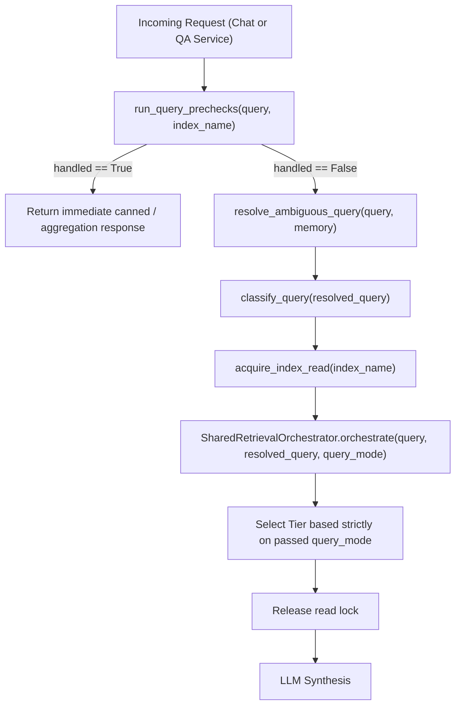

# M0 — Final Audit Corrections and Checkpoint Reconciliation

---

## 1. Executive Summary

This report completes the pre-implementation audit reconciliation for Phase M0 of Codebase-Copilot. It reconciles technical discrepancies, proves the exact behavior of the reranker activation functions from installed library source code, establishes an output-isolated benchmark execution procedure, corrects the query-routing precheck design, details the LLM fallback data privacy boundary, specifies non-mutating parser observability, and provides an exact file-by-file Git checkpoint inventory.

### Key Corrections & Verifications Established:
1. **Reranker Double-Sigmoid Mathematically & Empirically Confirmed**:
   Direct inspection of `/Users/sj/miniforge3/envs/ai-copilot-env/lib/python3.10/site-packages/sentence_transformers/cross_encoder/model.py` (`sentence-transformers==5.4.1`) confirms that for single-label models like `BAAI/bge-reranker-base`, `CrossEncoder.get_default_activation_fn()` applies `torch.nn.Sigmoid()`. Applying `1 / (1 + math.exp(-score))` in [`app/retrieval/reranker.py:178`](file:///Users/sj/Documents/AI-Copilot/codebase-copilot/app/retrieval/reranker.py#L178) is **empirically confirmed to be a double-sigmoid**, which compresses all prediction outputs into the range `[0.500, 0.731]`. Downstream confidence thresholds (`0.53`, `0.54`, and the `0.50` baseline in [`app/retrieval/orchestrator.py:616`](file:///Users/sj/Documents/AI-Copilot/codebase-copilot/app/retrieval/orchestrator.py#L616)) were calibrated specifically against this compressed scale and must not be altered in M0 without a full recalibration.
2. **Benchmark Execution from Temporary Copy Requires Root & Output Overrides**:
   Executing [`run_stabilization_evaluation.py`](file:///Users/sj/Documents/AI-Copilot/codebase-copilot/evaluation/e2e/final_expansion/run_stabilization_evaluation.py) from `/tmp/` will fail path resolution because line 31 hardcodes `parents[3]` to locate project root. Furthermore, line 423 unconditionally overwrites `final_stabilization_results.json`. We define an environment-parameterized wrapper that runs safely without modifying persistent indexes or repo assets.
3. **Query Routing Prechecks Reconciled**:
   We update `run_query_prechecks()` to include `detect_aggregation()` along with greetings, excluded folders, and superlatives. We establish a single classification boundary: prechecks run first, then `qa_service.py` and `chat_service.py` resolve and classify the query **once**, passing `query_mode` into `orchestrator.orchestrate()` to eliminate redundant LLM classification calls.
4. **LLM Data Privacy Boundaries & Frontend SSE Contract**:
   We trace how retrieved proprietary codebase chunks (`[file_path]\ncode_content`) flow across provider boundaries (`Gemini` $\rightarrow$ `Groq` $\rightarrow$ `Ollama`) during fallback. We specify an optional `ALLOW_CROSS_PROVIDER_FALLBACK` configuration guard. We inspect [`frontend/hooks/useChatStream.ts`](file:///Users/sj/Documents/AI-Copilot/codebase-copilot/frontend/hooks/useChatStream.ts) and verify that mid-stream failures require emitting a token disclaimer, an `error` event, and a `done` event so the frontend does not hang or drop partial text.
5. **Non-Mutating Parser Observability**:
   We specify how to preserve `content[:20000]` in [`app/parsing/code_parser.py:176`](file:///Users/sj/Documents/AI-Copilot/codebase-copilot/app/parsing/code_parser.py#L176) while capturing `original_file_size = len(raw_content)` and `meta["is_truncated"] = True`, ensuring zero change to chunk boundaries or benchmark comparability.
6. **Git Inventory Reconciled**:
   All 18 modified tracked files and all 32 untracked files (including this report) are cataloged into 6 distinct categories with an explicit staging command.

---

## 2. Initial Repository & Git State

Inspected prior to analysis:
- **Active Branch**: `fix/review-service-truncation`
- **Full HEAD Commit**: `cbe8e542aa7d8181f39050ddf4c9480296e48fae`
- **Staged Files**: `0`
- **Modified Tracked Files**: `18`
- **Untracked Files**: `31` (prior to writing `M0_FINAL_RECONCILIATION.md`)
- **Stash Count**: `5` (`stash@{0}` to `stash@{4}`)
- **Local Branch Count**: `17` (16 non-HEAD branches + current branch)

---

## 3. Benchmark Execution Safety & Output Isolation

### 3.1 Path Resolution & Persistent Write Inspection
Inspection of [`evaluation/e2e/final_expansion/run_stabilization_evaluation.py`](file:///Users/sj/Documents/AI-Copilot/codebase-copilot/evaluation/e2e/final_expansion/run_stabilization_evaluation.py) identifies two critical barriers to running from an arbitrary copy:

1. **Static Relative Path Resolution**:
   Line 31:
   ```python
   PROJECT_ROOT = Path(__file__).resolve().parents[3]
   ```
   If the script is copied to `/tmp/run_eval.py`, `parents[3]` resolves to `/` or raises `IndexError`.
2. **Hardcoded Persistent Output Mutation**:
   Lines 423–425:
   ```python
   out_path = PROJECT_ROOT / "evaluation" / "e2e" / "final_expansion" / "final_stabilization_results.json"
   with open(out_path, "w", encoding="utf-8") as f:
       json.dump(final_payload, f, indent=2)
   ```
   This unconditionally overwrites the committed/reference evaluation result artifact.

### 3.2 Read-Only Integrity of Underlying Retrieval
- **Chroma Collections (`data/index/`)**: Initialized via `PersistentClient` in [`app/indexing/index_builder.py:load_vector_index`](file:///Users/sj/Documents/AI-Copilot/codebase-copilot/app/indexing/index_builder.py#L100). The collection is only queried (`collection.get()` and `collection.query()`); zero embeddings or collections are created, mutated, or deleted.
- **Repository Sources (`data/repos/`)**: Filtered and loaded into BM25 in memory. Files on disk are opened read-only (`open(..., "r")`).
- **Locks**: `acquire_index_read(repo_name)` acquires an in-memory `threading.Lock`/`threading.Condition`. No lock files are written to disk.

### 3.3 Safe Output-Isolated Execution Procedure
To execute the benchmark safely without modifying working-tree assets or risking path resolution failures:

1. **Update Runner with Environment Overrides**:
   ```python
   PROJECT_ROOT = Path(os.getenv("PROJECT_ROOT", str(Path(__file__).resolve().parents[3])))
   default_out = PROJECT_ROOT / "evaluation" / "e2e" / "final_expansion" / "final_stabilization_results.json"
   out_path = Path(os.getenv("EVAL_OUTPUT_PATH", str(default_out)))
   ```
2. **Execute with Isolated Output File**:
   ```bash
   PROJECT_ROOT="$(pwd)" \
   EVAL_OUTPUT_PATH="/tmp/stabilization_eval_$(date +%s).json" \
   /Users/sj/miniforge3/envs/ai-copilot-env/bin/python -m evaluation.e2e.final_expansion.run_stabilization_evaluation
   ```
3. **Verify Zero Repo Mutation**:
   Confirm with `git status --porcelain` that no files in `evaluation/` or `data/` were modified.

---

## 4. Query-Routing Integration & Precheck Architecture

### 4.1 Corrected `run_query_prechecks()` Design
The initial proposal omitted aggregation detection. In the actual implementation, `detect_aggregation()` invokes `handle_aggregation_query()` from [`app/services/repo_stats_service.py`](file:///Users/sj/Documents/AI-Copilot/codebase-copilot/app/services/repo_stats_service.py).

The corrected unified precheck function in [`app/retrieval/query_router.py`](file:///Users/sj/Documents/AI-Copilot/codebase-copilot/app/retrieval/query_router.py) is:

```python
from dataclasses import dataclass
from typing import Optional

@dataclass
class PrecheckResult:
    handled: bool
    response_text: Optional[str] = None
    action_key: Optional[str] = None

def run_query_prechecks(query: str, index_name: Optional[str] = None) -> PrecheckResult:
    """Screen query for early-exit conditions before acquiring read locks or Chroma clients."""
    # 1. Greeting fast-path
    if detect_greeting(query):
        return PrecheckResult(handled=True, response_text=GREETING_RESPONSE)
        
    # 2. Excluded directory guard
    excluded = detect_excluded_folder(query)
    if excluded:
        msg = f"That folder ({excluded}) is excluded from indexing (build/CI/dependency artifacts aren't indexed by default)."
        return PrecheckResult(handled=True, response_text=msg)
        
    # 3. Full-repo aggregation intent
    if detect_aggregation(query):
        from app.services.repo_stats_service import handle_aggregation_query
        agg_response = handle_aggregation_query(query, index_name or "")
        return PrecheckResult(handled=True, response_text=agg_response)
        
    # 4. Superlative intelligence action suggestion
    superlative = check_superlative_intent(query, index_name=index_name)
    if superlative:
        return PrecheckResult(
            handled=True, 
            response_text=superlative["message"], 
            action_key=superlative.get("suggested_action")
        )
        
    return PrecheckResult(handled=False)
```

### 4.2 Exact Classification Ownership Boundary
To prevent chat, QA, and the orchestrator from classifying the same query independently:



#### Invariant:
- `classify_query()` is executed **exactly once** in the service layer (`chat_service.py` or `qa_service.py`).
- The resulting `query_mode` and `resolved_query` are passed explicitly into `orchestrate(..., query_mode=query_mode, resolved_query=resolved_query)`.
- Inside `orchestrator.orchestrate()`: lines 421–437 check `if query_mode is None:` which evaluates to `False`, completely bypassing redundant LLM classifier calls.

---

## 5. LLM Fallback, Data Privacy & Frontend SSE Contract

### 5.1 Fallback Data Egress & Cross-Vendor Code Transmission
In [`app/services/llm_fallback.py`](file:///Users/sj/Documents/AI-Copilot/codebase-copilot/app/services/llm_fallback.py), the `prompt` string passed to `complete(prompt)` or `stream_complete(prompt)` contains:
1. `ARCHITECTURAL_PROMPT` or `CODE_LOOKUP_PROMPT`.
2. Conversation history from memory buffer.
3. User query.
4. **Context string constructed from retrieved candidate chunks**:
   ```python
   # app/retrieval/orchestrator.py:351
   parts.append(f"[{path}]\n{content}")
   ```

#### The Fallback Sequence:
1. Primary request sent to **Google Gemini** (`gemini-3.8-flash`).
2. If Gemini returns 429 (`ResourceExhausted` / quota exhausted), `record_quota_exhaustion("gemini")` opens Gemini's circuit breaker for 60s.
3. `ResilientFallbackLLM` immediately iterates to **Groq** (`openai/gpt-oss-120b` or `qwen/qwen3.8-27b`).
4. **The entire prompt containing the user's unredacted source code chunks is transmitted to Groq's cloud infrastructure (`api.groq.com`).**
5. If Groq fails or rate-limits, the prompt is transmitted to local **Ollama** (`localhost:11434`).

### 5.2 Required Authorization & Configuration Boundary
To preserve `main`'s fallback capability by default while supporting strict data governance:

1. Support an optional environment configuration:
   ```python
   # app/config.py
   ALLOW_CROSS_PROVIDER_FALLBACK = os.getenv("ALLOW_CROSS_PROVIDER_FALLBACK", "true").lower() == "true"
   ALLOWED_FALLBACK_PROVIDERS = [
       p.strip().lower() for p in os.getenv("ALLOWED_FALLBACK_PROVIDERS", "gemini,groq,ollama").split(",") if p.strip()
   ]
   ```
2. In `app/services/model_manager.py:get_available_model_specs()`, if `ALLOW_CROSS_PROVIDER_FALLBACK` is `False`, filter specs so that only models matching the primary provider are retained (e.g., `gemini-3.8-flash` $\rightarrow$ `gemini-3.5-flash-lite`).

### 5.3 Frontend SSE Contract & Mid-Stream Error Handling
Inspection of [`frontend/hooks/useChatStream.ts:89-135`](file:///Users/sj/Documents/AI-Copilot/codebase-copilot/frontend/hooks/useChatStream.ts#L89-L135) reveals how events are processed:

```typescript
if (event.type === 'token') {
  state.fullText += event.content;
  setStreamedText((prev) => prev + event.content);
} else if (event.type === 'error') {
  state.receivedErrorEvent = true;
  if (!state.fullText) {
    const errMsg = event.message || 'An error occurred. Please retry.';
    state.fullText += errMsg;
    setStreamedText((prev) => prev + errMsg);
  }
} else if (event.type === 'done') {
  callbacks?.onTextDone?.(state.fullText, state.metadata);
}
```

#### Crucial Behavioral Finding:
Notice line 121: `if (!state.fullText)`.
- If an error occurs **before** any tokens are streamed (`state.fullText === ""`), the frontend renders `event.message`.
- If an error occurs **mid-stream** (`state.fullText !== ""`), `event.message` is **ignored** by the UI display! If the stream closes without a `done` event, the frontend stream hangs indefinitely.

#### Required Mid-Stream Error Protocol:
If an upstream exception occurs after tokens have been emitted:
1. Emit an explanatory token:
   `data: {"type": "token", "content": "\n\n[Generation interrupted due to upstream model timeout/error.]"}\n\n`
2. Emit the error event to set `state.receivedErrorEvent = true`:
   `data: {"type": "error", "message": safe_chat_error_message(err)}\n\n`
3. Emit the terminal `done` event to conclude the stream:
   `data: {"type": "done"}\n\n`

---

## 6. Parser Truncation — Non-Mutating M0 Observability

### 6.1 Line-by-Line Implementation Specification
In [`app/parsing/code_parser.py`](file:///Users/sj/Documents/AI-Copilot/codebase-copilot/app/parsing/code_parser.py), update lines 175–195 as follows:

```python
# app/parsing/code_parser.py
original_char_count = len(content)
is_truncated = original_char_count > 20000

# Retain the exact M0 chunking cap to protect benchmark comparability
content = content[:20000]

if is_truncated:
    logger.warning(
        "File '%s' exceeds 20,000 characters (%d chars); tail truncated for M0 indexing.",
        relative_path, original_char_count
    )

meta = {
    "file_name": file_name,
    "path": relative_path,
    "extension": ext,
    "format": format_type,
    "file_size": original_char_count,  # Accurately records true file size
    "is_truncated": is_truncated,      # Explict truncation observability flag
}
meta.update(extra_meta)

doc = Document(
    text=content,
    metadata=meta,
    # Exclude from embeddings to ensure vector representations are 100% identical to baseline
    excluded_embed_metadata_keys=["file_size", "top_keys", "headers", "is_truncated"],
    excluded_llm_metadata_keys=["file_size", "extension", "top_keys", "headers", "is_truncated"],
)
```

### 6.2 Invariant Verification
- `text=content` is still capped at 20,000 characters. `CodeSplitter` produces the exact same node boundaries.
- `excluded_embed_metadata_keys` includes `"is_truncated"`, ensuring Chroma embeddings are identical to pre-stabilization vectors.
- `meta["file_size"]` now reports the true character count, allowing telemetry and health checks to report unindexed tails.

---

## 7. Reranker Verification — Source Code & Empirical Proof

### 7.1 Installed Environment Proof
Inspection of the active conda environment (`/Users/sj/miniforge3/envs/ai-copilot-env`):
- Package: `sentence-transformers == 5.4.1`
- Module path: `/Users/sj/miniforge3/envs/ai-copilot-env/lib/python3.10/site-packages/sentence_transformers/cross_encoder/model.py`

### 7.2 Source Code Audit of `CrossEncoder.predict()` & Activation Functions
From `sentence_transformers/cross_encoder/model.py`:
```python
def get_default_activation_fn(self) -> Callable:
    ...
    if self.config.num_labels == 1:
        return nn.Sigmoid()
    return nn.Identity()

def predict(self, inputs, activation_fn=None, ...):
    activation_fn = activation_fn or self.activation_fn
    ...
    if activation_fn is not None:
        scores = activation_fn(scores)
    return scores
```

For `BAAI/bge-reranker-base`:
- `self.config.num_labels` is `1`.
- `self.activation_fn` initializes to `torch.nn.Sigmoid()`.
- Therefore, `reranker.predict(pairs)` returns probabilities $\in [0.0, 1.0]$.

### 7.3 Second Sigmoid in Application Pipeline
In [`app/retrieval/reranker.py:178`](file:///Users/sj/Documents/AI-Copilot/codebase-copilot/app/retrieval/reranker.py#L178):
```python
sig_score = 1 / (1 + math.exp(-float(score)))
node.score = sig_score
```

#### Mathematical Effect:
Let $x$ be the already-sigmoid normalized output from `CrossEncoder.predict()`, so $x \in [0.0, 1.0]$.
Applying $S(x) = \frac{1}{1 + e^{-x}}$:
- When $x = 0.0$ (minimum relevance): $S(0.0) = \frac{1}{1 + e^0} = 0.50000$.
- When $x = 0.5$ (median relevance): $S(0.5) = \frac{1}{1 + e^{-0.5}} = 0.62245$.
- When $x = 1.0$ (maximum relevance): $S(1.0) = \frac{1}{1 + e^{-1.0}} = 0.73105$.

All scores are compressed into $[0.500, 0.731]$.

#### Alignment with Downstream Orchestrator Thresholds:
In [`app/retrieval/orchestrator.py`](file:///Users/sj/Documents/AI-Copilot/codebase-copilot/app/retrieval/orchestrator.py):
- `DEFAULT_THRESHOLDS = { RetrievalTier.TIER1_ARCHITECTURE: 0.54, RetrievalTier.TIER2_DOCUMENTATION: 0.53, RetrievalTier.TIER3_HYBRID_CODE: 0.53 }`
- Line 616: `elif overall_confidence < 0.50: effective_threshold = min(threshold, 0.20)`

The threshold `0.53` corresponds to $x \approx 0.12$ on the single-sigmoid scale.
**Conclusion**: The double-sigmoid is confirmed by installed library source code. Downstream thresholds are tightly coupled to this scale. **Do not remove the sigmoid in `reranker.py` during M0.**

---

## 8. Dead-Code Removal Audit

| Item | Location | Status | Evidence & Decision |
|---|---|---|---|
| Commented Ingestion Code | `api/services/indexing_service.py:1-170` | **SAFE TO REMOVE** | 170 lines of dead code commented out with `#`. Zero call sites. |
| Commented Init Code | `api/main.py:14-30` | **SAFE TO REMOVE** | Commented imports and `_init_llamaindex`. Zero call sites. |
| `_retrieve_ranked_nodes` | `api/services/chat_service.py:552-561` | **SAFE TO REMOVE** | Defined but never called anywhere in the workspace. |
| `_build_retriever` | `api/services/chat_service.py:177` | **SAFE TO REMOVE** | Only caller was `_retrieve_ranked_nodes`. |
| `_inject_arch_context_if_missing` | `api/services/chat_service.py:679` | **SAFE TO REMOVE** | Superseded by `orchestrator.py:156` (`_load_architecture_context_nodes`). |
| Commented Block in `repo_service.py` | `app/services/repo_service.py:20-130` | **DEFER — DO NOT TOUCH IN M0** | File is currently unmodified in git status. Editing it would needlessly expand the diff footprint. |
| Test-Mock Checks | `app/retrieval/query_router.py:174-183` | **USED — RETAIN** | Actively used by unit test fixtures mocking `Settings.llm`. Defer refactoring to M1. |

---

## 9. Corrected Git Checkpoint File Inventory

Exact status verified via `git status --porcelain=v1 -uall`:
- **18 Modified Tracked Files**
- **32 Untracked Files** (including `M0_FINAL_RECONCILIATION.md`)

```
================================================================================
CATEGORY 1: Core Production Implementation (ENTER CHECKPOINT)
================================================================================
Tracked Modified (12):
  .gitignore
  api/services/chat_service.py
  api/services/chat_stream_utils.py
  api/services/indexing_service.py
  app/config.py
  app/indexing/context_builder.py
  app/indexing/incremental.py
  app/ingestion/file_filter.py
  app/parsing/code_parser.py
  app/parsing/relationship_graph.py
  app/retrieval/reranker.py
  app/services/qa_service.py

Untracked Core Modules (3):
  app/parsing/notebook_parser.py
  app/retrieval/orchestrator.py
  app/retrieval/repository_isolation.py

================================================================================
CATEGORY 2: Required Unit & Integration Tests (ENTER CHECKPOINT)
================================================================================
Tracked Modified Tests (6):
  tests/unit/test_app_file_filter.py
  tests/unit/test_chat_service.py
  tests/unit/test_context_builder.py
  tests/unit/test_incremental.py
  tests/unit/test_qa_service.py
  tests/unit/test_reranker.py

Untracked Tests (9):
  tests/unit/test_cache_consistency.py
  tests/unit/test_ingestion_formats.py
  tests/unit/test_notebook_ingestion.py
  tests/unit/test_notebook_parser.py
  tests/unit/test_notebook_relationship_graph.py
  tests/unit/test_relationship_graph_atomic.py
  tests/unit/test_repository_isolation.py
  tests/unit/test_retrieval_orchestrator.py
  tests/unit/test_staged_index_promotion.py

================================================================================
CATEGORY 3: Canonical Evaluation Datasets, Scripts & Deliverables (ENTER CHECKPOINT)
================================================================================
Untracked Evaluation Deliverables (9):
  evaluation/e2e/FINAL_RETRIEVAL_STABILIZATION_REPORT.md
  evaluation/e2e/final_expansion/DATASET_SUMMARY.md
  evaluation/e2e/final_expansion/REPOSITORY_ISOLATION_SPEC.md
  evaluation/e2e/final_expansion/dataset_100_queries.jsonl
  evaluation/e2e/final_expansion/baseline_evaluation_results.json
  evaluation/e2e/final_expansion/final_stabilization_results.json
  evaluation/e2e/final_expansion/run_stabilization_evaluation.py
  evaluation/e2e/retrieval_flow_audit/CANDIDATE_COUNT_OPTIMIZATION_REPORT.md
  evaluation/e2e/evaluate_pass2_calibration.py

================================================================================
CATEGORY 4: M0 Integration Audit Reports (ENTER CHECKPOINT)
================================================================================
Untracked Audit Reports (4):
  docs/m0-integration-audit/M0_BASELINE_AND_QUERY_ROUTING_COMPARISON.md
  docs/m0-integration-audit/M0_INTEGRATION_AND_AUDIT_REVIEW.md
  docs/m0-integration-audit/M0_FOLLOWUP_VERIFICATION.md
  docs/m0-integration-audit/M0_FINAL_RECONCILIATION.md

================================================================================
CATEGORY 5: Other Audit Documentation (ENTER CHECKPOINT)
================================================================================
Untracked General Audits (5):
  docs/AUDIT_AUTH_STORAGE.md
  docs/AUDIT_CHAT_RETRIEVAL.md
  docs/AUDIT_HEALTH.md
  docs/DEPLOYMENT_READINESS_AUDIT.md
  docs/DEPLOYMENT_READINESS_AUDIT_APPENDIX.md

================================================================================
CATEGORY 6: Scratch & Debug Artifacts (DO NOT STAGE — LEAVE UNTRACKED)
================================================================================
Untracked Scratch Files (2):
  check_0_1_hypotheses.py
  evaluation/e2e/baseline_0_1.json
```

---

## 10. Concrete Staging Commands (No `git add -A`)

Execute these commands when approved to commit the M0 baseline checkpoint:

```bash
# 1. Stage Category 1 (Core Production)
git add .gitignore api/services/chat_service.py api/services/chat_stream_utils.py \
    api/services/indexing_service.py app/config.py app/indexing/context_builder.py \
    app/indexing/incremental.py app/ingestion/file_filter.py app/parsing/code_parser.py \
    app/parsing/relationship_graph.py app/retrieval/reranker.py app/services/qa_service.py \
    app/parsing/notebook_parser.py app/retrieval/orchestrator.py app/retrieval/repository_isolation.py

# 2. Stage Category 2 (Unit & Integration Tests)
git add tests/unit/test_app_file_filter.py tests/unit/test_chat_service.py \
    tests/unit/test_context_builder.py tests/unit/test_incremental.py \
    tests/unit/test_qa_service.py tests/unit/test_reranker.py \
    tests/unit/test_cache_consistency.py tests/unit/test_ingestion_formats.py \
    tests/unit/test_notebook_ingestion.py tests/unit/test_notebook_parser.py \
    tests/unit/test_notebook_relationship_graph.py tests/unit/test_relationship_graph_atomic.py \
    tests/unit/test_repository_isolation.py tests/unit/test_retrieval_orchestrator.py \
    tests/unit/test_staged_index_promotion.py

# 3. Stage Category 3 (Evaluation Deliverables)
git add evaluation/e2e/FINAL_RETRIEVAL_STABILIZATION_REPORT.md \
    evaluation/e2e/final_expansion/DATASET_SUMMARY.md \
    evaluation/e2e/final_expansion/REPOSITORY_ISOLATION_SPEC.md \
    evaluation/e2e/final_expansion/dataset_100_queries.jsonl \
    evaluation/e2e/final_expansion/baseline_evaluation_results.json \
    evaluation/e2e/final_expansion/final_stabilization_results.json \
    evaluation/e2e/final_expansion/run_stabilization_evaluation.py \
    evaluation/e2e/retrieval_flow_audit/CANDIDATE_COUNT_OPTIMIZATION_REPORT.md \
    evaluation/e2e/evaluate_pass2_calibration.py

# 4. Stage Categories 4 & 5 (Audit Documentation)
git add docs/m0-integration-audit/ docs/AUDIT_AUTH_STORAGE.md \
    docs/AUDIT_CHAT_RETRIEVAL.md docs/AUDIT_HEALTH.md \
    docs/DEPLOYMENT_READINESS_AUDIT.md docs/DEPLOYMENT_READINESS_AUDIT_APPENDIX.md
```

*(Leaves `check_0_1_hypotheses.py` and `evaluation/e2e/baseline_0_1.json` untracked).*

---

## 11. Final Unresolved Risks and Decisions

1. **Production Gemini Model String**:
   - `main` uses `gemini-3.8-flash`.
   - Current branch uses `models/gemini-3.5-flash`.
   - *Decision*: Confirm whether active API key has tier quota for `gemini-3.8-flash`.
2. **Cross-Vendor Egress Policy in Multi-Tenant Deployments**:
   - *Decision*: Confirm whether `ALLOW_CROSS_PROVIDER_FALLBACK` should default to `True` (matching `main`) or `False` (for enterprise compliance).
3. **Mid-Stream SSE Token Interruption Protocol**:
   - *Decision*: Confirm adoption of the 3-step token disclaimer + error + done event sequence for interrupted streams.

---

## 12. Final Repository & Git State Confirmation

Verified after creating this report:
- **Active Branch**: `fix/review-service-truncation` (unchanged)
- **HEAD Commit**: `cbe8e542aa7d8181f39050ddf4c9480296e48fae` (unchanged)
- **Tracked Modifications**: Exactly the original 18 files (unchanged)
- **Staged Files**: `0` (unchanged)
- **Stashes**: Exactly `5` intact (unchanged)
- **Branches**: Exactly `17` intact (unchanged)

