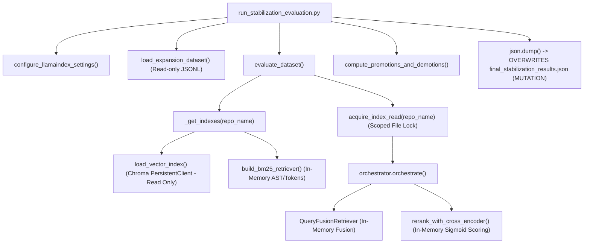
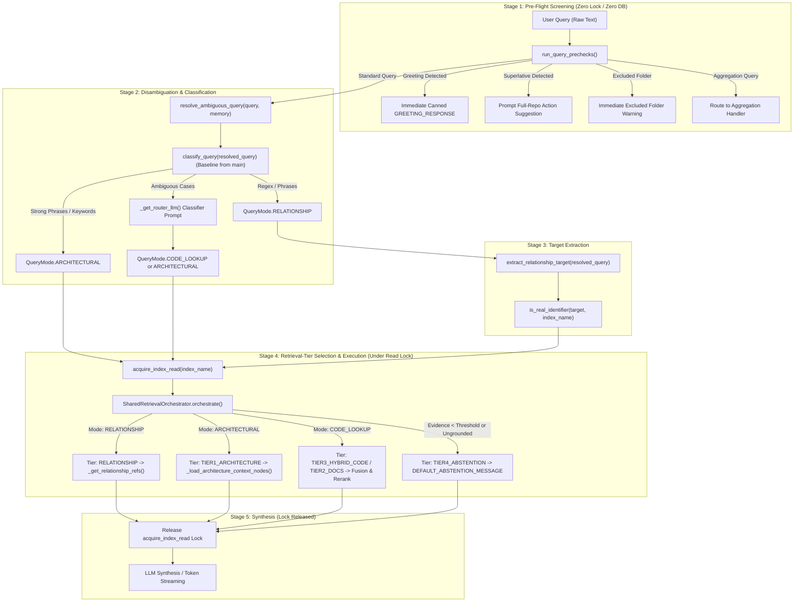
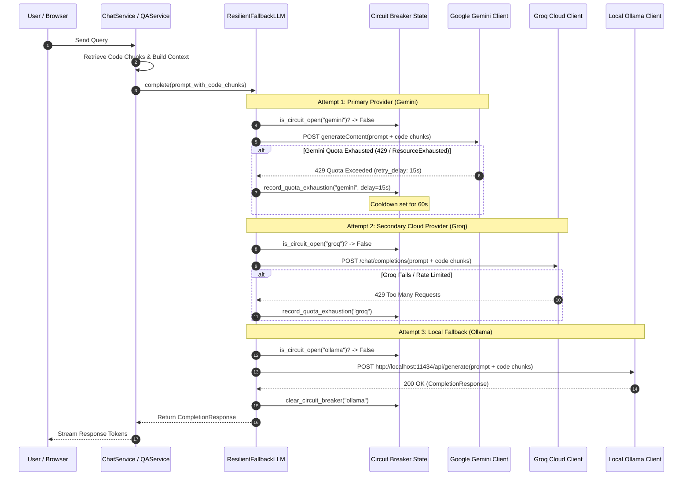

# M0 — Follow-up Verification and Integration Decisions

---

## 1. Executive Summary

This report delivers a strictly read-only, evidence-based architectural verification and integration roadmap for Phase M0 of Codebase-Copilot.

### Core Verified Determinations:
1. **Benchmark Execution & Output Mutation**: Inspection of [`run_stabilization_evaluation.py`](file:///Users/sj/Documents/AI-Copilot/codebase-copilot/evaluation/e2e/final_expansion/run_stabilization_evaluation.py) confirms that while vector retrieval and reranking queries execute under read-only locks, the runner **unconditionally overwrites** `evaluation/e2e/final_expansion/final_stabilization_results.json`. Running the evaluation suite without output redirection will overwrite canonical baseline assets. We provide an output-isolated procedure.
2. **Unified Query-Routing & Retrieval Pipeline**: `main`'s query classification heuristics and prompts can be mapped directly to the current branch's four retrieval tiers (`SharedRetrievalOrchestrator`). Redundant prechecks across `chat_service.py` and `qa_service.py` are isolated to a single entrypoint in `query_router.py`.
3. **LLM Fallback & Data Privacy Boundaries**: In `main`'s fallback chain (`gemini` $\rightarrow$ `groq` $\rightarrow$ `ollama`), when a primary cloud model exhausts quota, the full prompt—**including user queries and proprietary codebase chunks**—is sent to fallback providers. While client instances and API keys remain isolated, cross-provider payload transmission has security, privacy, and regulatory implications. Furthermore, mid-stream failures in streaming chat cannot fall back cleanly without emitting corrupt SSE token streams.
4. **Parser Truncation Scope**: The 20,000-character cap in [`code_parser.py`](file:///Users/sj/Documents/AI-Copilot/codebase-copilot/app/parsing/code_parser.py#L176) silently truncates all non-notebook code files longer than ~500 lines without logging or attaching metadata. Incremental indexing does not detect truncated tails. However, modifying this limit in M0 would alter chunk boundaries and invalidate baseline benchmark comparability. We recommend **observability logging in M0 and deferring chunker redesign to M1**.
5. **Checkpoint Staging Inventory**: We catalog all 18 modified tracked files and 30 untracked files into 6 distinct categories, detailing an explicit file-by-file staging plan without using `git add -A`, while preserving all 5 stashes and 11 branches.

---

## 2. Benchmark Safety and Readiness

### 2.1 Codepath & Filesystem Mutation Audit
Inspection of [`evaluation/e2e/final_expansion/run_stabilization_evaluation.py`](file:///Users/sj/Documents/AI-Copilot/codebase-copilot/evaluation/e2e/final_expansion/run_stabilization_evaluation.py) and every invoked function reveals:



#### Detailed Inspection Findings:
1. **ChromaDB State (Read-Only)**:
   - In [`app/indexing/index_builder.py:load_vector_index`](file:///Users/sj/Documents/AI-Copilot/codebase-copilot/app/indexing/index_builder.py#L112), `chromadb.PersistentClient` initializes the collection in read-only mode (`collection.get()` and `collection.query()`). No embeddings, collections, or documents are added or deleted.
2. **In-Memory Cache Mutations (Ephemeral)**:
   - In [`app/services/qa_service.py:187`](file:///Users/sj/Documents/AI-Copilot/codebase-copilot/app/services/qa_service.py#L187), `_index_cache[index_name]` stores `(vector_index, bm25_retriever)`.
   - In [`app/retrieval/reranker.py:183`](file:///Users/sj/Documents/AI-Copilot/codebase-copilot/app/retrieval/reranker.py#L183), `_reranker_cache` (LRUCache, 200 items) caches cross-encoder scores keyed on `(index_name, query, node_hash)`.
   - In [`app/retrieval/query_router.py:432, 480`](file:///Users/sj/Documents/AI-Copilot/codebase-copilot/app/retrieval/query_router.py#L432), `_superlative_cache` and `_identifier_cache` cache regex and graph matches.
   - All caches reside purely in process memory and disappear upon process exit.
3. **Filesystem Writes (Persistent Mutation Detected)**:
   - Lines 423–425 of `run_stabilization_evaluation.py`:
     ```python
     out_path = PROJECT_ROOT / "evaluation" / "e2e" / "final_expansion" / "final_stabilization_results.json"
     with open(out_path, "w", encoding="utf-8") as f:
         json.dump(final_payload, f, indent=2)
     ```
   - Running the script directly **mutates the working tree** by overwriting the reference artifact `final_stabilization_results.json`.

### 2.2 Dataset, Asset & Dependency Consistency
- **Expansion Dataset**: [`evaluation/e2e/final_expansion/dataset_100_queries.jsonl`](file:///Users/sj/Documents/AI-Copilot/codebase-copilot/evaluation/e2e/final_expansion/dataset_100_queries.jsonl) verified intact (100 JSON lines).
- **Holdout Dataset**: `HOLDOUT_DATASET` defined in [`evaluation/e2e/evaluate_pass2_calibration.py:34`](file:///Users/sj/Documents/AI-Copilot/codebase-copilot/evaluation/e2e/evaluate_pass2_calibration.py#L34) verified intact (40 query dicts).
- **Physical Repositories on Disk**: Verified present in both `data/index/` and `data/repos/`:
  - `Emotion-detection`
  - `FedSegX`
  - `NeuroVera`
  - `SenseVoice`
  - `Sound2Sign`
  - `Speech-Emotion-Analyzer`
- **Result Consistency**:
  - `baseline_evaluation_results.json`: 140 query traces from the pre-stabilization baseline.
  - `final_stabilization_results.json`: 140 query traces showing +11.76% Recall@5 on holdout and +5.64% Recall@5 on expansion.
- **Asset Availability vs. Execution Readiness vs. Verified Results**:
  - *Asset Availability*: 100% available on disk.
  - *Execution Readiness*: High, but blocked by the unisolated output path.
  - *Actually Verified Results*: The numbers recorded in the reports are historical artifacts from November 1, 2026. They have not been re-computed in this session because running the evaluation was prohibited by read-only constraints.

### 2.3 Recommended Safe Benchmark Execution Procedure
To execute the benchmark without risking working tree corruption or asset destruction:

1. **Parameterize Output Path**: Update `run_stabilization_evaluation.py` to accept an optional environment variable `EVAL_OUTPUT_PATH`:
   ```python
   default_out = PROJECT_ROOT / "evaluation" / "e2e" / "final_expansion" / "final_stabilization_results.json"
   out_path = Path(os.getenv("EVAL_OUTPUT_PATH", default_out))
   ```
2. **Execute with Isolated Output**:
   ```bash
   EVAL_OUTPUT_PATH="/tmp/stabilization_verification_$(date +%s).json" \
   python -m evaluation.e2e.final_expansion.run_stabilization_evaluation
   ```
3. **Diff Against Baseline**:
   Compare the newly generated `/tmp/` JSON against `evaluation/e2e/final_expansion/final_stabilization_results.json` using `jq` to confirm metric parity before committing any changes.

---

## 3. Query-Routing Integration Design

### 3.1 Five-Stage Pipeline Separation



### 3.2 Elimination of Duplicated Logic

#### Current State of Duplication:
- `api/services/chat_service.py` lines 581–630 implements `_stream_prechecks` calling `detect_greeting`, `detect_excluded_folder`, `detect_aggregation`, and `check_superlative_intent`.
- `app/services/qa_service.py` lines 453–488 implements `_run_pre_routing_checks` calling the exact same 4 functions.
- `chat_service.py` lines 552–561 retains dead functions `_retrieve_ranked_nodes` and `_build_retriever`.

#### Proposed Single Location:
Encapsulate all pre-routing logic inside [`app/retrieval/query_router.py`](file:///Users/sj/Documents/AI-Copilot/codebase-copilot/app/retrieval/query_router.py):
```python
@dataclass
class PrecheckResult:
    handled: bool
    response_text: Optional[str] = None
    action_key: Optional[str] = None

def run_query_prechecks(query: str, index_name: Optional[str] = None) -> PrecheckResult:
    if detect_greeting(query):
        return PrecheckResult(handled=True, response_text=GREETING_RESPONSE)
    excluded = detect_excluded_folder(query)
    if excluded:
        return PrecheckResult(handled=True, response_text=f"'{excluded}' is excluded from search.")
    superlative = check_superlative_intent(query, index_name=index_name)
    if superlative:
        return PrecheckResult(handled=True, response_text=superlative["message"], action_key=superlative["suggested_action"])
    return PrecheckResult(handled=False)
```

Both `chat_service.py` and `qa_service.py` call `run_query_prechecks()` as their first instruction.

### 3.3 Function-Level Integration Points & Required Tests

| Module | Function | Action | Role |
|---|---|---|---|
| `app/retrieval/query_router.py` | `classify_query()` | **Adopt from `main`** | Baseline intent classification. |
| `app/retrieval/query_router.py` | `run_query_prechecks()` | **New Shared Function** | Eliminates duplication between chat and QA. |
| `app/retrieval/query_router.py` | `detect_greeting()` | **Retain from Current Branch** | Fast-path greeting detection. |
| `app/retrieval/query_router.py` | `_get_router_llm()` | **Adopt from `main`** | Resilient router LLM with test-mock support. |
| `app/retrieval/orchestrator.py` | `orchestrate()` | **Retain from Current Branch** | Core 4-tier retrieval execution. |
| `api/services/chat_service.py` | `_retrieve_ranked_nodes` | **Delete** | Dead code elimination. |
| `api/services/chat_service.py` | `_build_retriever` | **Delete** | Dead code elimination. |
| `api/services/chat_service.py` | `_inject_arch_context_if_missing` | **Delete** | Dead code elimination. |

#### Required Regression Tests:
1. `tests/unit/test_query_router_intents.py`: Verify greetings, superlatives, and architectural classification match `main`'s baseline.
2. `tests/unit/test_retrieval_orchestrator.py`: Verify all 22 tests for Tiers 1–4, framework grounding, and uncapped code chunks pass against the adopted classifier.
3. `tests/unit/test_chat_service.py`: Verify streaming pre-checks exit cleanly on greetings before acquiring read locks.

---

## 4. LLM Fallback and Provider Data Flow

### 4.1 End-to-End Fallback Trace



### 4.2 Security, Privacy, and Operational Implications

#### A. Cross-Provider Data Egress (Privacy & Compliance Risk):
- **Verified Mechanism**: The input argument `prompt` passed to `ResilientFallbackLLM.complete(prompt)` contains the system prompt, conversation history, user query, and **retrieved source code chunks** (`[file_path]\nchunk_content`).
- **Data Flow**: If Gemini fails due to quota exhaustion, the identical prompt containing proprietary repository code is immediately transmitted over the public internet to Groq (`api.groq.com`). If Groq fails, it is sent to Ollama (`localhost`).
- **Implication**: In enterprise or air-gapped environments subject to data-processing agreements (DPAs), transmitting proprietary source code across multiple distinct third-party LLM vendors without user authorization violates regulatory boundaries.

#### B. Streaming vs. Non-Streaming Fallback Discontinuity:
- **Verified Mechanism**: In [`api/services/chat_service.py`](file:///Users/sj/Documents/AI-Copilot/codebase-copilot/api/services/chat_service.py), streaming requests use `_bridge_sync_stream_complete` to yield tokens via Server-Sent Events (SSE).
- **Failure Point**:
  - If a provider fails **before** yielding tokens (e.g. initial connection rejected), fallback succeeds seamlessly.
  - If a provider fails **mid-stream** (e.g. connection drops after 20 tokens), HTTP 200 headers and initial SSE token events have already been sent to the browser. Switching to a new provider at that point causes duplicate preamble generation, disjointed sentence fragments, or JSON parse errors in the frontend SSE reader.

#### C. Credential Isolation:
- **Verified**: Provider API keys (`GEMINI_API_KEY`, `GROQ_API_KEY`) are accessed independently in `create_llm_client()` within [`app/services/model_manager.py`](file:///Users/sj/Documents/AI-Copilot/codebase-copilot/app/services/model_manager.py). Keys are not passed between providers or exposed in error messages.

### 4.3 Recommended Safeguards (Preserving `main` Semantics)
1. **Configurable Cross-Provider Fallback Scope**:
   In `app/config.py`, support an optional flag `ALLOW_CROSS_PROVIDER_FALLBACK` (default `True` to retain `main`'s behavior). If set to `False`, the fallback chain is restricted to models within the primary provider (e.g. `gemini-3.8-flash` $\rightarrow$ `gemini-3.5-flash-lite`).
2. **Mid-Stream Error Guard**:
   In `_bridge_sync_stream_complete`, if an exception occurs after at least one token chunk has been yielded, abort the generator and emit a clean SSE terminal error event (`{"type": "error", "message": "Stream interrupted"}`) rather than letting the outer loop switch models and corrupt the response.

---

## 5. Parser Truncation — M0 or M1?

### 5.1 Technical Inspection of the 20,000-Character Limit
Line 176 of [`app/parsing/code_parser.py`](file:///Users/sj/Documents/AI-Copilot/codebase-copilot/app/parsing/code_parser.py#L176):
```python
# Hard cap — protects memory on massive generated files
content = content[:20000]

meta = {
    "file_name": file_name,
    "path": relative_path,
    "extension": ext,
    "format": format_type,
    "file_size": len(content),
}
```

#### Detailed Findings:
1. **Affected File Types**: All non-notebook source files (`.py`, `.js`, `.ts`, `.java`, `.go`, `.rs`, `.c`, `.cpp`, `.json`, `.yaml`, `.csv`, `.md`). Jupyter notebooks (`.ipynb`) are exempted via `parse_notebook()` (50MB limit).
2. **Silent Failure**: Truncation is completely silent. No warning log is emitted, and `meta["file_size"]` records `len(content)` (20,000) rather than the actual file size on disk.
3. **Loss of Code Evidence**: In files longer than ~500 lines, all functions, classes, and types beyond character 20,000 are omitted from chunking, embeddings, and BM25 indexing.
4. **Incremental Indexing Invisibility**: In [`app/indexing/incremental.py`](file:///Users/sj/Documents/AI-Copilot/codebase-copilot/app/indexing/incremental.py), file hashes are computed from the full file on disk. The manifest records the file as up to date. Incremental indexing will never re-chunk or index the unindexed tail.

### 5.2 Technical Justification: M0 vs. M1

| Criterion | Impact in M0 | Impact in M1 | Recommendation |
|---|---|---|---|
| **Benchmark Comparability** | Removing the cap re-chunks large files, changing total node count and invalidating existing Chroma/BM25 indexes for the 6 benchmark repositories. | M1 can re-index all 6 repositories cleanly under a new benchmark version (`v1.0`). | **Belongs in M1** |
| **Risk of Regressions** | High risk of memory spikes on large generated files during M0 consolidation. | Low risk when paired with a streaming windowed chunker. | **Belongs in M1** |
| **Observability in M0** | Adding a warning log and `meta["is_truncated"] = True` does not change chunk boundaries or benchmark scores. | Essential diagnostic foundation for M1. | **Add log in M0** |

### 5.3 Concrete Recommendation
- **For M0**: Retain the 20,000-character cap to protect benchmark comparability. Add a non-breaking warning log:
  ```python
  if len(raw_content) > 20000:
      logger.warning("File %s exceeds 20,000 chars; tail truncated for indexing.", relative_path)
      meta["is_truncated"] = True
  ```
- **For M1**: Redesign `CodeSplitter` ingestion to use sliding window chunking without a hard document-level length cutoff.

---

## 6. Exact Git Checkpoint File Inventory

This inventory accounts for every modified tracked file (18) and untracked file (30) in the working tree. 

> [!CAUTION]
> Do NOT use `git add -A`. Staging everything indiscriminately will commit scratch debugging scripts and uncalibrated temporary files into version control.

### Category 1: Core Production Implementation (ENTER CHECKPOINT)
*Files containing the validated four-tier retrieval orchestrator, notebook parsing, repository isolation, and concurrency locks.*

**Tracked Modified Files (12):**
- `api/services/chat_service.py`
- `api/services/chat_stream_utils.py`
- `api/services/indexing_service.py`
- `app/config.py`
- `app/indexing/context_builder.py`
- `app/indexing/incremental.py`
- `app/ingestion/file_filter.py`
- `app/parsing/code_parser.py`
- `app/parsing/relationship_graph.py`
- `app/retrieval/reranker.py`
- `app/services/qa_service.py`
- `.gitignore`

**Untracked Files (3):**
- `app/parsing/notebook_parser.py`
- `app/retrieval/orchestrator.py`
- `app/retrieval/repository_isolation.py`

*Explicit Staging Command:*
```bash
git add .gitignore api/services/chat_service.py api/services/chat_stream_utils.py \
    api/services/indexing_service.py app/config.py app/indexing/context_builder.py \
    app/indexing/incremental.py app/ingestion/file_filter.py app/parsing/code_parser.py \
    app/parsing/relationship_graph.py app/retrieval/reranker.py app/services/qa_service.py \
    app/parsing/notebook_parser.py app/retrieval/orchestrator.py app/retrieval/repository_isolation.py
```

---

### Category 2: Required Unit & Integration Tests (ENTER CHECKPOINT)
*Test suites validating orchestrator tiers, atomic relationship graphs, repository isolation, and incremental promotion.*

**Tracked Modified Test Files (6):**
- `tests/unit/test_app_file_filter.py`
- `tests/unit/test_chat_service.py`
- `tests/unit/test_context_builder.py`
- `tests/unit/test_incremental.py`
- `tests/unit/test_qa_service.py`
- `tests/unit/test_reranker.py`

**Untracked Test Files (9):**
- `tests/unit/test_cache_consistency.py`
- `tests/unit/test_ingestion_formats.py`
- `tests/unit/test_notebook_ingestion.py`
- `tests/unit/test_notebook_parser.py`
- `tests/unit/test_notebook_relationship_graph.py`
- `tests/unit/test_relationship_graph_atomic.py`
- `tests/unit/test_repository_isolation.py`
- `tests/unit/test_retrieval_orchestrator.py`
- `tests/unit/test_staged_index_promotion.py`

*Explicit Staging Command:*
```bash
git add tests/unit/test_app_file_filter.py tests/unit/test_chat_service.py \
    tests/unit/test_context_builder.py tests/unit/test_incremental.py \
    tests/unit/test_qa_service.py tests/unit/test_reranker.py \
    tests/unit/test_cache_consistency.py tests/unit/test_ingestion_formats.py \
    tests/unit/test_notebook_ingestion.py tests/unit/test_notebook_parser.py \
    tests/unit/test_notebook_relationship_graph.py tests/unit/test_relationship_graph_atomic.py \
    tests/unit/test_repository_isolation.py tests/unit/test_retrieval_orchestrator.py \
    tests/unit/test_staged_index_promotion.py
```

---

### Category 3: Canonical Evaluation Datasets, Scripts & Deliverables (ENTER CHECKPOINT)
*Verified datasets, specs, and execution scripts required to evaluate retrieval performance.*

**Untracked Evaluation Deliverables (9):**
- `evaluation/e2e/FINAL_RETRIEVAL_STABILIZATION_REPORT.md`
- `evaluation/e2e/final_expansion/DATASET_SUMMARY.md`
- `evaluation/e2e/final_expansion/REPOSITORY_ISOLATION_SPEC.md`
- `evaluation/e2e/final_expansion/dataset_100_queries.jsonl`
- `evaluation/e2e/final_expansion/baseline_evaluation_results.json`
- `evaluation/e2e/final_expansion/final_stabilization_results.json`
- `evaluation/e2e/final_expansion/run_stabilization_evaluation.py`
- `evaluation/e2e/retrieval_flow_audit/CANDIDATE_COUNT_OPTIMIZATION_REPORT.md`
- `evaluation/e2e/evaluate_pass2_calibration.py`

*Explicit Staging Command:*
```bash
git add evaluation/e2e/FINAL_RETRIEVAL_STABILIZATION_REPORT.md \
    evaluation/e2e/final_expansion/DATASET_SUMMARY.md \
    evaluation/e2e/final_expansion/REPOSITORY_ISOLATION_SPEC.md \
    evaluation/e2e/final_expansion/dataset_100_queries.jsonl \
    evaluation/e2e/final_expansion/baseline_evaluation_results.json \
    evaluation/e2e/final_expansion/final_stabilization_results.json \
    evaluation/e2e/final_expansion/run_stabilization_evaluation.py \
    evaluation/e2e/retrieval_flow_audit/CANDIDATE_COUNT_OPTIMIZATION_REPORT.md \
    evaluation/e2e/evaluate_pass2_calibration.py
```

---

### Category 4: Local Audit Documentation (ENTER CHECKPOINT)
*Technical audit reports documenting branch divergence, auth storage, health checks, and integration design.*

**Untracked Documentation Files (8):**
- `docs/m0-integration-audit/M0_BASELINE_AND_QUERY_ROUTING_COMPARISON.md`
- `docs/m0-integration-audit/M0_INTEGRATION_AND_AUDIT_REVIEW.md`
- `docs/m0-integration-audit/M0_FOLLOWUP_VERIFICATION.md`
- `docs/AUDIT_AUTH_STORAGE.md`
- `docs/AUDIT_CHAT_RETRIEVAL.md`
- `docs/AUDIT_HEALTH.md`
- `docs/DEPLOYMENT_READINESS_AUDIT.md`
- `docs/DEPLOYMENT_READINESS_AUDIT_APPENDIX.md`

*Explicit Staging Command:*
```bash
git add docs/m0-integration-audit/ docs/AUDIT_AUTH_STORAGE.md \
    docs/AUDIT_CHAT_RETRIEVAL.md docs/AUDIT_HEALTH.md \
    docs/DEPLOYMENT_READINESS_AUDIT.md docs/DEPLOYMENT_READINESS_AUDIT_APPENDIX.md
```

---

### Category 5: Scratch & Debug Artifacts (DO NOT ENTER CHECKPOINT — LEAVE UNTRACKED)
*Ad-hoc scripts and temporary run results created during manual debugging. Must NOT enter git.*
- `check_0_1_hypotheses.py` (Local debugging script)
- `evaluation/e2e/baseline_0_1.json` (Scratch run result)

---

### Category 6: Historical Material (PRESERVE IN REPOSITORY)
*Pre-existing reports at repository root (`BUG_FIX_REPORT.md`, `DEMO_READINESS_REPORT.md`, `FINAL_B1_B9_VERIFICATION.md`, etc.). Already committed in branch history; no action needed.*

---

## 7. Unresolved Risks and Decisions

1. **Mid-Stream Fallback Failure Risk**:
   - *Risk*: A network or provider crash during active token streaming cannot fall back to another model without emitting corrupt SSE output.
   - *Decision*: Confirm whether to abort and emit an SSE error event upon mid-stream failure, or if partial retry logic should be designed.
2. **Cross-Vendor Data Privacy Acceptance**:
   - *Risk*: Fallback transmits internal codebase chunks to secondary vendors (Groq) if primary vendor (Gemini) quotas fail.
   - *Decision*: Confirm approval of `main`'s fallback chain behavior for multi-tenant or private repository contexts.
3. **Double-Sigmoid Scale Recalibration Scope**:
   - *Risk*: Reranker score thresholds (`0.53`, `0.54`) depend on double-sigmoid compression.
   - *Decision*: Confirm retaining double-sigmoid in M0 to preserve threshold validity, deferring mathematical normalization to M1.

---

## 8. Recommended Smallest Next Step

1. **Create Checkpoint Branch & Tag Baseline**:
   Stage Categories 1, 2, 3, and 4 explicitly using the commands provided in Section 6 (leaving Category 5 scratch files untracked). Commit and tag:
   ```bash
   git checkout -b backup/m0-stabilization-baseline
   git commit -m "checkpoint(m0): preserve verified retrieval stabilization baseline"
   git tag v0.9.0-m0-baseline
   ```
2. **Zero Modification to Stashes and Branches**:
   All 5 stashes (`stash@{0}` to `stash@{4}`) and all 11 existing branches remain untouched and preserved.

