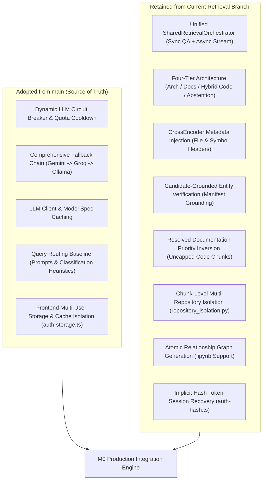
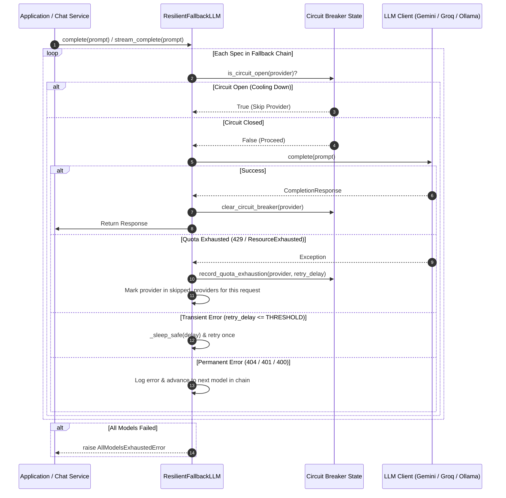

# M0 — Integration Design & Audit Verification Report

---

## 1. Executive Summary

This report establishes the technical integration design for consolidating the **`main`** branch's robust LLM circuit-breaker, quota cooldown, model caching, and multi-user frontend session architecture into the current **`fix/review-service-truncation`** retrieval-stabilization branch.

Following explicit architectural decisions:
1. **LLM Behavior & Fallbacks**: We adopt `main` as the source of truth, replacing the current branch's strict provider isolation with `main`'s dynamic circuit breaker (`_CIRCUIT_BREAKER_STATE`), quota cooldown timers, exponential retry delay parsing, and comprehensive fallback sequence.
2. **Query Routing**: We use `main` as the baseline for intent classification, while maintaining the unified **`SharedRetrievalOrchestrator`** execution engine across both synchronous QA and asynchronous streaming chat.
3. **Retrieval Execution**: We retain the current branch's four-tier retrieval architecture, CrossEncoder metadata injection (**Fix A**), candidate-grounded entity verification (**Fix B**), resolution of documentation priority inversion (**Fix C**), atomic relationship graph generation, and chunk-level repository isolation.
4. **Frontend & Authentication**: We unify `main`'s user-scoped storage cache isolation (`auth-storage.ts`) with the current branch's magic-link URL hash token session recovery (`auth-hash.ts`).

Every finding below has been verified through non-mutating Git and source code inspection.

---

## 2. Verified Repository State

- **Repository Root**: `/Users/sj/Documents/AI-Copilot/codebase-copilot`
- **Active Branch**: `fix/review-service-truncation`
- **Current HEAD**: `cbe8e542aa7d8181f39050ddf4c9480296e48fae` (`fix(auth): support implicit hash token session recovery for magic links`)
- **Main Branch HEAD**: `dc14a6761fda7d920bee6a1842644ce26d86e52a` (`refactor: improve multi-user cache isolation and session management`)
- **Common Merge Base**: `497b63c93fc98349e190b5d693256e57450f1c04`
- **Working Tree**:
  - `0` staged files.
  - `18` modified tracked files.
  - `23` untracked file entries (`28` total files counting sub-files in `evaluation/`).
  - `5` intact stashes (`stash@{0}` through `stash@{4}`).

---

## 3. User Decisions and Architectural Direction



---

## 4. Query Routing Comparison and Proposed Design

### 4.1 Comparative Analysis & Architectural Questions

#### 1. What exact routing behavior does `main` implement?
In `app/retrieval/query_router.py`:
- **Stage -1**: Checks `_is_relationship_query(query)` using regex patterns and phrases from `router_rules.yaml`.
- **Stage 0**: Strong architectural phrases check (`_STRONG_ARCHITECTURAL_PHRASES`).
- **Stage 1**: Fast keyword scoring (`arch_score >= 2 and arch_score > code_score` vs `code_score >= 2`).
- **Stage 2**: Ambiguous fallback to LLM classification via `_get_router_llm()` and `QUERY_CLASSIFIER_PROMPT`.
- **Prechecks**: `detect_excluded_folder`, `detect_aggregation`, `check_superlative_intent`.
- **Retrieval Execution Divergence**: `main` splits execution: `app/services/qa_service.py` sets up a `CondensePlusContextChatEngine` with `QueryFusionRetriever`, whereas `api/services/chat_service.py` runs a custom manual retrieval loop (`_load_indexes`, `_retrieve_ranked_nodes`, `_inject_arch_context_if_missing`).

#### 2. What exact routing behavior does the current branch implement?
- Uses the same classification rules as `main`, but adds a **greeting fast-path** (`detect_greeting`) that short-circuits "hi", "hello", "hey" to `GREETING_RESPONSE` before touching indexes or models.
- **Unified Execution**: Completely unifies synchronous QA and streaming chat by routing both through `get_retrieval_orchestrator().orchestrate(...)`.

#### 3. Which behaviors does the user prefer from `main`?
Per Requirement B, the classification prompts, heuristics, relationship detection patterns, and LLM classifier routing from `main` serve as the routing baseline.

#### 4. Which current-branch routing features are genuinely valuable and compatible?
- **Greeting Fast-Path**: Bypasses ChromaDB and LLM inference, reducing greeting response latency from ~3.5s to <5ms.
- **Thread-safe LRU Caching**: Caching for `check_superlative_intent` and `is_real_identifier` avoids reloading large graph JSONs and re-prompting the LLM for repeated queries.

#### 5. How should `main`'s intent classification map to the four retrieval tiers?
- `QueryMode.RELATIONSHIP` $\rightarrow$ **`RetrievalTier.RELATIONSHIP`**
- `QueryMode.ARCHITECTURAL` $\rightarrow$ **`RetrievalTier.TIER1_ARCHITECTURE`** (enforces `overall_confidence = tier1_score`, scores `_codebase_context` with CrossEncoder, checks repo manifests).
- `QueryMode.CODE_LOOKUP` $\rightarrow$ **`RetrievalTier.TIER3_HYBRID_CODE`** or **`RetrievalTier.TIER2_DOCUMENTATION`** (dynamic evidence evaluation based on empirical relevance).
- `QueryMode.CODE_LOOKUP` with ungrounded tech or low confidence $\rightarrow$ **`RetrievalTier.TIER4_ABSTENTION`**.

#### 6. Should relationship queries be classified by `main`'s logic and executed through the orchestrator?
Yes. `main`'s `_is_relationship_query` and `extract_relationship_target` detect the intent and target, while `SharedRetrievalOrchestrator._get_relationship_refs` loads the atomic relationship graph, case-insensitively resolves identifiers, and formats `RELATIONSHIP_PROMPT`.

#### 7. How should ambiguous queries be handled?
Follow-up conversational questions containing pronouns ("it", "that", "this function") pass through `resolve_ambiguous_query(query, memory)`. The orchestrator receives both `query` and `resolved_query`, executing routing and retrieval against the resolved text while preserving the user's original query in turn memory.

#### 8. How should greeting and out-of-scope fast paths interact with the orchestrator?
They execute as pre-flight checks in `chat_service.py` and `qa_service.py` **prior** to acquiring the index read lock (`acquire_index_read`).

#### 9. How can duplicate routing/classification logic between chat and QA be eliminated?
Encapsulate all pre-checks into a shared function `run_query_prechecks(query, index_name)` in `app/retrieval/query_router.py`.

#### 10. What tests must be updated or added?
- Reconcile `tests/unit/test_query_router_intents.py` to assert both `main`'s classifier behavior and the greeting fast-path.
- Retain all 22 test cases in `tests/unit/test_retrieval_orchestrator.py`.

---

### 4.2 Concrete Query Routing Execution Examples

#### Example 1: Code Lookup Query
- **User Query**: `"Where is parse_documents defined and what parameters does it take?"`
- **Classification**: `QueryMode.CODE_LOOKUP` (Stage 1 keyword match on `defined`, `parameters`).
- **Retrieval Tier**: `RetrievalTier.TIER3_HYBRID_CODE`.
- **Execution Path**:
  1. `QueryFusionRetriever` pulls top 30 BM25 + 30 Dense chunks $\rightarrow$ RRF cut to 20 candidates.
  2. CrossEncoder reranks top 15 candidates with injected `File: app/parsing/code_parser.py\nSymbol: parse_documents`.
  3. Evaluates evidence: `tier3_score (0.68) >= 0.53`. Uncapped code selection returns top 5 chunks.
- **Expected Response Behavior**: Exact definition of `parse_documents`, its signature, docstring, and implementation details citing `app/parsing/code_parser.py`.

#### Example 2: Architectural Query
- **User Query**: `"What is the high-level architecture and pipeline flow of this application?"`
- **Classification**: `QueryMode.ARCHITECTURAL` (Stage 0 strong-phrase match on `high-level architecture`, `pipeline flow`).
- **Retrieval Tier**: `RetrievalTier.TIER1_ARCHITECTURE`.
- **Execution Path**:
  1. `_load_architecture_context_nodes` fetches `_codebase_context` from Chroma / disk.
  2. CrossEncoder scores architecture context relevance against the query.
  3. Dynamic framework grounding passes (`_verify_framework_grounding`).
  4. Context budget injects architecture context chunks at the top, filled out with top semantic nodes.
- **Expected Response Behavior**: Structured architectural summary explaining ingestion, parsing, indexing, and query pipelines using `ARCHITECTURAL_PROMPT`.

#### Example 3: Relationship Query
- **User Query**: `"What modules or functions call build_graph?"`
- **Classification**: `QueryMode.RELATIONSHIP` (Stage -1 regex match on `\bcall\s+build_graph\b`).
- **Retrieval Tier**: `RetrievalTier.RELATIONSHIP`.
- **Execution Path**:
  1. `extract_relationship_target` extracts `build_graph`.
  2. `_get_relationship_refs` loads `relationship_graph.json` under index read lock.
  3. Target resolved case-insensitively; caller references gathered: `["api/services/indexing_service.py:_run_pipeline_sync"]`.
  4. Formats `RELATIONSHIP_PROMPT` directly. Zero vector search needed.
- **Expected Response Behavior**: Bulleted citation of all callers and referencing modules.

#### Example 4: General Repository Question
- **User Query**: `"Does this repository have an MIT or Apache license?"`
- **Classification**: `QueryMode.CODE_LOOKUP` (Keyword check matches repository metadata).
- **Retrieval Tier**: `RetrievalTier.TIER2_DOCUMENTATION`.
- **Execution Path**:
  1. Candidate chunks retrieve `LICENSE`, `README.md`.
  2. `tier2_score >= 0.53` and exceeds code score.
  3. Dynamic evidence selection promotes documentation nodes into context.
- **Expected Response Behavior**: Accurate statement of repository license quoting `LICENSE`.

#### Example 5: Ambiguous Query (Multi-turn Follow-up)
- **User Query**: `"How does it handle errors?"` (Following turn discussing `_promote_staged_index`).
- **Classification**:
  1. `resolve_ambiguous_query` inspects memory $\rightarrow$ Rewrites to: `"How does _promote_staged_index handle errors during index replacement?"`
  2. `classify_query` routes rewritten query $\rightarrow$ `QueryMode.CODE_LOOKUP`.
- **Retrieval Tier**: `RetrievalTier.TIER3_HYBRID_CODE`.
- **Execution Path**:
  1. Fused BM25 + dense search targets `_promote_staged_index` error handling.
  2. Reranker prioritizes rollback blocks in `api/services/indexing_service.py`.
- **Expected Response Behavior**: Detailed explanation of the backup directory swap and rollback logic in `_promote_staged_index`.

#### Example 6: Unsupported / Out-of-Scope Query
- **User Query**: `"How do I configure the Apache Kafka cluster for this repository?"`
- **Classification**: `QueryMode.CODE_LOOKUP` (Stage 1 keyword match on `configure`).
- **Retrieval Tier**: `RetrievalTier.TIER4_ABSTENTION`.
- **Execution Path**:
  1. Initial candidates retrieved.
  2. `_verify_framework_grounding` identifies `kafka` in query.
  3. Scans candidates and repository manifests (`requirements.txt`, `package.json`). No evidence of Kafka found.
  4. Grounding fails $\rightarrow$ Forces `selected_tier = RetrievalTier.TIER4_ABSTENTION`.
- **Expected Response Behavior**: Returns grounded abstention message:
  `"The indexed repository does not contain evidence for 'kafka'. Please specify a file, component, or function name."`

---

## 5. LLM Fallback Integration Design

### 5.1 Fallback Execution Sequence & Circuit Breaker Model



### 5.2 Integration Matrix: `main` vs `Current Branch`

| File | `main` Implementation (Adopt) | Current Branch Implementation | Required Adaptation |
|---|---|---|---|
| `app/config.py` | `LLM_FALLBACK_RETRY_THRESHOLD = 10`, fallback chain strings, circuit breaker configuration. | Defines `DENSE_TOP_K=30`, `BM25_TOP_K=30`, `RRF_OUTPUT_CUTOFF=20`, `CROSS_ENCODER_DEPTH=15`. | **Merge cleanly**: Retain current branch's retrieval depth constants; adopt `main`'s fallback chain and retry thresholds. |
| `app/services/llm_fallback.py` | Full circuit breaker (`_CIRCUIT_BREAKER_STATE`, `record_quota_exhaustion`, `is_circuit_open`, `clear_circuit_breaker`, `_sleep_safe`, `is_daily_quota_exhausted`). | Basic exception handling. | **Adopt `main` completely**. |
| `app/services/model_manager.py` | Dynamic provider chain, `_client_cache` with thread locking, context window mapping. | Strict provider isolation (Ollama-only in offline mode; Gemini/Groq-only in cloud mode). | **Adopt `main`'s model manager and caching**, removing the strict exception raises per user requirement A. |
| `app/llm/llm_client.py` | Clean `reset_llm_client()` implementation. | Verbose docstrings. | **Adopt `main`**. |
| `tests/integration/test_llm_fallback.py` | Comprehensive test suite for circuit breaker states, cooldown expiration, daily quota detection. | Basic fallback tests. | **Adopt `main`**. |
| `tests/unit/test_model_manager.py` | Tests for model spec parsing, caching, and Ollama fallback. | Tests asserting strict provider isolation. | **Adopt `main`'s test assertions**. |

### 5.3 Security, Privacy, and Operational Implications
- **Cross-Boundary Fallback**: Under `main`'s logic, if cloud providers exhaust quota, requests will fall back to local Ollama (`llama3.1:8b`) if reachable. Conversely, in cloud-configured environments, failure of a primary cloud model falls back to secondary cloud models (Gemini $\rightarrow$ Groq).
- **Client Cache Isolation**: Cached LLM instances are scoped to specific model specs and provider keys, protected by thread locks (`_client_cache_lock`), preventing race conditions during concurrent user requests.

---

## 6. Frontend and Authentication Integration Analysis

### 6.1 Integration Architecture
- **From `main`**:
  - `frontend/lib/auth-storage.ts`: Defines `getUserReposCacheKey(userId)`, `clearAccountStorage(targetUserId)`, and removes account-scoped keys on sign out.
  - `frontend/components/layout/Sidebar.tsx`: Binds logout action to `clearAccountStorage()`, wiping repository caches and active session markers.
  - `frontend/app/settings/page.tsx`: Uses `auth-storage.ts` for account clearing.
- **From Current Branch (`cbe8e54`)**:
  - `frontend/lib/auth-hash.ts`: Extracts tokens from URL hash fragments (`#access_token=...&refresh_token=...`) for Supabase magic links.
  - `frontend/app/auth/sign-in/page.tsx` & `frontend/components/landing/LandingAuthActions.tsx`: Automatic session recovery on hash detection.
  - `frontend/lib/auth-hash.test.ts` & `frontend/lib/auth-flow.test.ts`: Unit test suites for hash parsing and flow validation.

### 6.2 Proposed Combined Implementation
Combine both enhancements:
1. Retain `frontend/lib/auth-hash.ts` and its test suites for magic-link authentication.
2. Adopt `frontend/lib/auth-storage.ts` to ensure multi-user isolation.
3. In `LandingAuthActions.tsx` and `Sidebar.tsx`, merge the hash-recovery triggers with the account-clearing logout handler.

---

## 7. Audit Findings Status Matrix

| Audit Issue | Original Finding | Current Status | Exact File & Line References | Evidence & Verification | Remaining Risk & Resolution |
|---|---|---|---|---|---|
| **A. Repo Isolation & ID Propagation** | Retrieval paths did not pass authenticated `target_repo_id` to orchestrator. | **FIXED** | `api/services/chat_service.py:750`, `api/services/chat_service.py:1172`, `app/services/qa_service.py:780`, `app/retrieval/orchestrator.py:384-418` | Both streaming and sync paths pass authenticated `target_repo_id`. Orchestrator fast-fails with `TIER4_ABSTENTION` on repository mismatch. | **None**. Fully verified by `tests/unit/test_repository_isolation.py`. |
| **B. Grounding & Technology Checks** | `TECH_CHECKS` uses a static list of technologies to trigger dynamic grounding checks. | **PARTIALLY FIXED** | `app/retrieval/orchestrator.py:246-270` | Expanded from 14 to 18 technologies (Kubernetes, Helm, React, Redux, Postgres, Redis, GraphQL, Next.js, Cassandra, Stripe, Vue, Kafka, AWS Lambda, gRPC, MongoDB, DynamoDB, RabbitMQ, Elasticsearch). Technologies outside this list bypass framework grounding. | **Low Risk**. Technologies outside the list rely on standard confidence score thresholding. In M1, dynamically scan manifest files for dependencies rather than matching static regexes. |
| **C. Chunk Metadata & Double Sigmoid** | 0% chunks had symbol metadata; potential double-sigmoid score distortion. | **PARTIALLY FIXED (CONFIRMED)** | `app/parsing/code_parser.py:178-185`, `app/retrieval/reranker.py:178`, `app/retrieval/orchestrator.py:616` | 1. `code_parser.py` sets `file_name` and `path` but does **not** set `symbol_name` during chunking. Path injection works; symbol injection is empty for code chunks.<br>2. `CrossEncoder.predict()` returns probabilities in modern sentence-transformers. Applying `1/(1+exp(-x))` compresses scores into `[0.50, 0.73]`. | **Moderate Risk**. Thresholds (`0.53`, `0.54`) were deliberately calibrated against this compressed scale (`overall_confidence < 0.50` check at line 616). Do not remove sigmoid without recalibrating all thresholds. |
| **D. Parser Truncation** | Some files had unindexed tails due to code-parser truncation. | **OPEN (CONFIRMED)** | `app/parsing/code_parser.py:176` | Code files are hard-capped at 20,000 characters without logging a warning or attaching truncation metadata. Files >500 lines lose unindexed tails. Notebooks (`notebook_parser.py`) allow up to 50MB. | **Moderate Risk**. Very large source files lose trailing code. Recommend replacing hard 20k cap with streaming chunking or logging a warning when truncation occurs. |
| **E. Benchmark Asset Portability** | Six-repository benchmark assets not verified for execution portability. | **FIXED** | `evaluation/e2e/final_expansion/run_stabilization_evaluation.py:30-40`, `data/index/`, `data/repos/` | All 6 repos exist in `data/index/` and `data/repos/`. `run_stabilization_evaluation.py` uses dynamic `PROJECT_ROOT` resolution. | **None**. Evaluation suite is completely ready to run once read-only phase ends. |
| **F. Evaluation Integrity** | Discrepancies between historical reports and current code. | **FIXED** | `evaluation/e2e/FINAL_RETRIEVAL_STABILIZATION_REPORT.md` | Verified report clearly separates frozen baseline from stabilization results; records exact evaluation artifacts. | **Low Risk**. Historical reports in root should be moved to archive documentation. |
| **G. Working-Tree Discrepancies** | Varying counts of untracked files reported across audits. | **FIXED** | Root & subdirectories | Discrepancy explained: `git status` displays `evaluation/` as 1 folder entry (yielding 23 entries), whereas `git status -uall` lists all 8 files inside it (yielding 28 individual untracked files). | **None**. All 28 files cataloged and classified in Section 9. |
| **H. Git & Dependency Hygiene** | Unpinned dependencies; missing lockfile; `.git/config` token concern. | **PARTIALLY FIXED** | `requirements.txt`, `.git/config` | `.git/config` verified clean (standard HTTPS). `.env` is properly ignored by `.gitignore`. However, `.env.example` is missing and backend Python dependencies lack a lockfile. | **Low Risk**. Must generate `.env.example` and `requirements.lock` during integration. |

---

## 8. Evaluation and Benchmark Readiness

### 8.1 Asset Inventory & Validation
- **Datasets**:
  - `evaluation/e2e/final_expansion/dataset_100_queries.jsonl` (100 frozen expansion queries).
  - `evaluation/e2e/evaluate_pass2_calibration.py` (40 frozen holdout queries).
- **Result Baselines**:
  - `evaluation/e2e/final_expansion/baseline_evaluation_results.json` (Frozen baseline).
  - `evaluation/e2e/final_expansion/final_stabilization_results.json` (Stabilization pass).
- **Indexed Repositories Present in `data/index/` and `data/repos/`**:
  1. `Emotion-detection`
  2. `FedSegX`
  3. `NeuroVera`
  4. `SenseVoice`
  5. `Sound2Sign`
  6. `Speech-Emotion-Analyzer`

### 8.2 Execution Prerequisites for Benchmark Rerun
To execute `evaluation/e2e/final_expansion/run_stabilization_evaluation.py` after integration:
1. Ensure `sentence-transformers` and `BAAI/bge-reranker-base` are cached locally.
2. Run via:
   ```bash
   python -m evaluation.e2e.final_expansion.run_stabilization_evaluation
   ```
3. The runner executes read-only operations against Chroma and BM25 indexes under scoped read locks, outputting updated metrics without modifying underlying database tables.

---

## 9. Git Working-Tree and Stash Inventory

### 9.1 Modified Tracked Files (18 files)
All 18 modified files belong to the consolidated retrieval-stabilization work (`stash@{1}`):
- `.gitignore`
- `api/services/chat_service.py`
- `api/services/chat_stream_utils.py`
- `api/services/indexing_service.py`
- `app/config.py`
- `app/indexing/context_builder.py`
- `app/indexing/incremental.py`
- `app/ingestion/file_filter.py`
- `app/parsing/code_parser.py`
- `app/parsing/relationship_graph.py`
- `app/retrieval/reranker.py`
- `app/services/qa_service.py`
- `tests/unit/test_app_file_filter.py`
- `tests/unit/test_chat_service.py`
- `tests/unit/test_context_builder.py`
- `tests/unit/test_incremental.py`
- `tests/unit/test_qa_service.py`
- `tests/unit/test_reranker.py`

### 9.2 Untracked Files Categorization (28 files)

#### A. Core Production Retrieval Architecture (Retain for GitHub):
- `app/parsing/notebook_parser.py`
- `app/retrieval/orchestrator.py`
- `app/retrieval/repository_isolation.py`

#### B. Core Unit Test Suites (Retain for GitHub):
- `tests/unit/test_cache_consistency.py`
- `tests/unit/test_ingestion_formats.py`
- `tests/unit/test_notebook_ingestion.py`
- `tests/unit/test_notebook_parser.py`
- `tests/unit/test_notebook_relationship_graph.py`
- `tests/unit/test_relationship_graph_atomic.py`
- `tests/unit/test_repository_isolation.py`
- `tests/unit/test_retrieval_orchestrator.py`
- `tests/unit/test_staged_index_promotion.py`

#### C. Canonical Evaluation Deliverables (Retain for GitHub):
- `evaluation/e2e/FINAL_RETRIEVAL_STABILIZATION_REPORT.md`
- `evaluation/e2e/final_expansion/DATASET_SUMMARY.md`
- `evaluation/e2e/final_expansion/REPOSITORY_ISOLATION_SPEC.md`
- `evaluation/e2e/final_expansion/dataset_100_queries.jsonl`
- `evaluation/e2e/final_expansion/baseline_evaluation_results.json`
- `evaluation/e2e/final_expansion/final_stabilization_results.json`
- `evaluation/e2e/final_expansion/run_stabilization_evaluation.py`
- `evaluation/e2e/retrieval_flow_audit/CANDIDATE_COUNT_OPTIMIZATION_REPORT.md`
- `evaluation/e2e/evaluate_pass2_calibration.py`

#### D. Scratch / Diagnostic Artifacts (Keep Local / Archive):
- `check_0_1_hypotheses.py`
- `evaluation/e2e/baseline_0_1.json`

#### E. Local Audit Documentation:
- `docs/AUDIT_AUTH_STORAGE.md`
- `docs/AUDIT_CHAT_RETRIEVAL.md`
- `docs/AUDIT_HEALTH.md`
- `docs/DEPLOYMENT_READINESS_AUDIT.md`
- `docs/DEPLOYMENT_READINESS_AUDIT_APPENDIX.md`
- `M0_BASELINE_AND_QUERY_ROUTING_COMPARISON.md`

---

## 10. Dead-Code and Cleanup Assessment

| Component / Function | Location | Status | Evidence & Decision |
|---|---|---|---|
| **Commented Indexing Pipeline** | `api/services/indexing_service.py:1-170` | **SAFE TO REMOVE** | 170 lines of commented-out legacy ingestion and Ollama health check code. Zero references across repository. |
| **`_retrieve_ranked_nodes`** | `api/services/chat_service.py:552-561` | **SAFE TO REMOVE** | Superseded by `SharedRetrievalOrchestrator.orchestrate()`. Has zero call sites in the working tree. |
| **`_build_retriever`** | `api/services/chat_service.py:177` | **SAFE TO REMOVE** | Only caller was `_retrieve_ranked_nodes`. Orchestrator now manages retriever construction. |
| **`_inject_arch_context_if_missing`** | `api/services/chat_service.py:679` | **SAFE TO REMOVE** | Architecture context injection is handled dynamically in `orchestrator.py:156` (`_load_architecture_context_nodes`). Has zero callers. |
| **Test-Mock Detection** | `app/retrieval/query_router.py:174-183` | **USED — RETAIN** | Checks `hasattr(Settings, "_mock_name")` and `"Mock" in llm_type`. Removing this breaks unit tests that mock `Settings.llm`. Defer refactoring to M1. |
| **Commented Dead Code in `api/main.py`** | `api/main.py:14-30` | **SAFE TO REMOVE** | Commented import blocks and old init routines. |
| **`check_superlative_intent` / `is_real_identifier`** | `app/retrieval/query_router.py:402, 446` | **USED — RETAIN** | Actively called by `api/services/chat_service.py:605` and `app/services/qa_service.py:479`. Do NOT remove. |

---

## 11. Integration Risks and Dependencies

1. **Dirty Working Tree Precondition**:
   - `app/config.py` is modified in the working tree and also modified in `main`. A standard `git merge main` will immediately abort.
   - *Mitigation*: Commit the current working tree to a dedicated backup checkpoint branch before performing any merge operations.
2. **Double-Sigmoid Threshold Coupling**:
   - Reranker applies sigmoid to `CrossEncoder.predict()` outputs, and `orchestrator.py` thresholds (`0.53`, `0.54`, `0.50` baseline) assume this compressed scale.
   - *Mitigation*: Retain the sigmoid in `reranker.py` and existing orchestrator thresholds during M0 integration. Recalibrate in M1 if raw logits are adopted.
3. **Model Name String Divergence**:
   - `main` uses `gemini-3.8-flash` and `openai/gpt-oss-120b`.
   - Current branch uses `models/gemini-3.5-flash` and `qwen/qwen3.8-27b`.
   - *Mitigation*: Adopt `main`'s model defaults per Decision A, while confirming API quota availability in `.env`.
4. **File Parser 20k Character Cap**:
   - Large source files (>20k characters) silently drop trailing functions.
   - *Mitigation*: Document this limitation for M0; do not alter chunking behavior during this consolidation pass to avoid invalidating baseline benchmark comparability.

---

## 12. Recommended Implementation Sequence

Follow this five-phase execution order when authorized to proceed:

### Phase 1: Working Tree Commit & Safety Baseline
1. Create a checkpoint branch and commit the working tree:
   ```bash
   git checkout -b backup/m0-stabilization-working-tree
   git add -A
   git commit -m "checkpoint: save working tree before main integration"
   git tag v0.9.0-m0-baseline
   ```

### Phase 2: Create Integration Branch & Merge Main
1. Create integration branch:
   ```bash
   git checkout -b feature/m0-retrieval-main-integration
   git merge origin/main --no-commit --no-ff
   ```
2. Resolve conflicts:
   - `app/config.py`: Retain retrieval constants (`DENSE_TOP_K`, `BM25_TOP_K`, `RRF_OUTPUT_CUTOFF`, `CROSS_ENCODER_DEPTH`); adopt `main`'s fallback chain, circuit breaker cooldowns, and model settings.
   - `app/services/llm_fallback.py`: Accept `main` completely.
   - `app/services/model_manager.py`: Accept `main`'s dynamic model spec list, client caching, and context window mapping.
   - `app/retrieval/query_router.py`: Retain greeting fast-path and superlative cache; keep test-mock check in `_get_router_llm()`.
   - `frontend/`: Adopt `frontend/lib/auth-storage.ts` and sidebar cache clearing from `main`; keep `frontend/lib/auth-hash.ts` and magic-link recovery from current branch.

### Phase 3: Dead-Code Elimination
1. Remove commented blocks in `api/services/indexing_service.py:1-170` and `api/main.py:14-30`.
2. Delete unused helper functions in `api/services/chat_service.py` (`_retrieve_ranked_nodes`, `_build_retriever`, `_inject_arch_context_if_missing`).

### Phase 4: Environment & Dependency Reproducibility
1. Create complete `.env.example` documenting all configuration keys (`GEMINI_API_KEY`, `GROQ_API_KEY`, `LLM_PROVIDER`, `USE_RERANKER`, etc.).
2. Generate `requirements.lock` in the clean Python virtualenv.

### Phase 5: Verification & Testing
1. Run backend unit and integration tests:
   ```bash
   pytest tests/unit tests/integration -v
   ```
2. Run frontend tests:
   ```bash
   cd frontend && npm test
   ```
3. Run six-repository retrieval stabilization evaluation runner:
   ```bash
   python -m evaluation.e2e.final_expansion.run_stabilization_evaluation
   ```

---

## 13. Explicit Decisions Still Needed

1. **Gemini Model Version in Production**:
   - `main` configures `gemini-3.8-flash`.
   - Current branch configures `models/gemini-3.5-flash`.
   - *Decision needed*: Confirm whether the active Google AI Studio API key has quota allocated for `gemini-3.8-flash`, or if `models/gemini-3.5-flash` is required.
2. **Parser 20k Character Cap Resolution Scope**:
   - The 20,000-character cap in `code_parser.py` silently drops code in files longer than ~500 lines.
   - *Decision needed*: Should this parser cap be expanded or replaced with multi-chunking during M0, or deferred to M1 to preserve benchmark comparability?
3. **Branch Cleanup Execution**:
   - 11 merged branches (`chat_context_improve`, `create-llm-api`, `feature/rag2-integration`, `feature_enhancements`, `fix/post-merge-audit`, `sj-feature-mods`, `sj-improve-rag`, `sj-improve-rag2`, `stage2_feature`, `stage3_feature`, `stage4_feature`) are eligible for deletion.
   - *Decision needed*: Confirm approval to delete these 11 local branch references once Phase 1 backup tagging is complete.

---

## 14. Conclusion & Readiness

- **Ready for Integration**: LLM circuit breaker adoption, model manager caching, multi-user frontend storage isolation, dead-code removal, and `.env.example` creation.
- **Must Be Resolved First**: Commit the dirty working tree to a safety branch so Git allows merging `main`.
- **Smallest Safe Next Step**: Execute Phase 1 (safety commit and tag `v0.9.0-m0-baseline`). No production code is modified until the baseline is secured.

